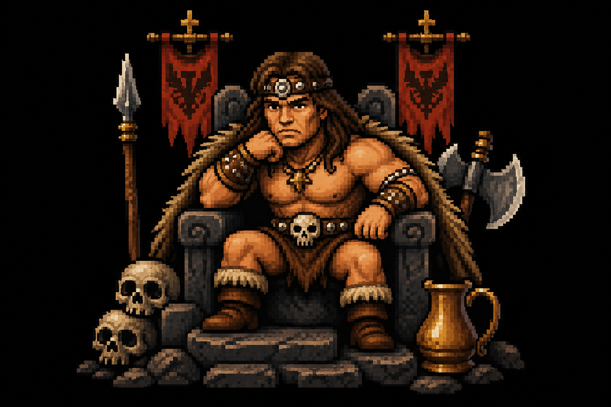
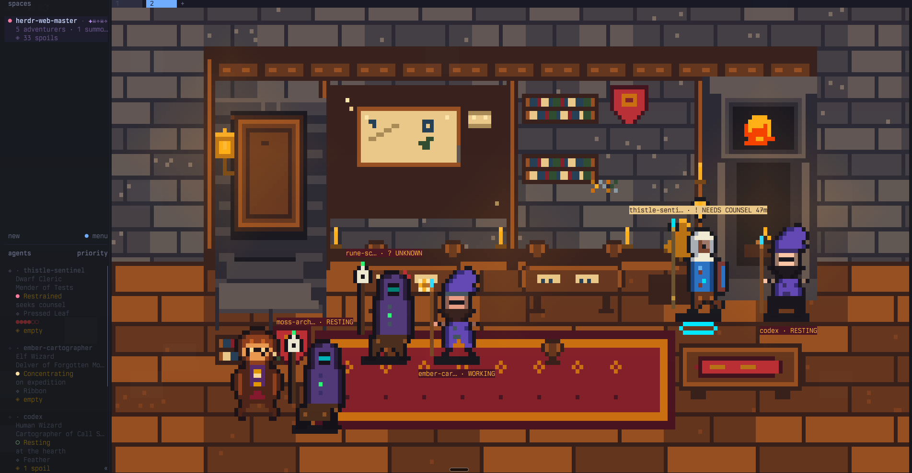
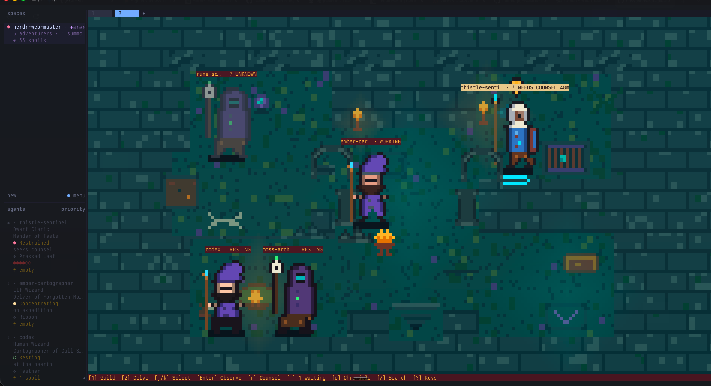
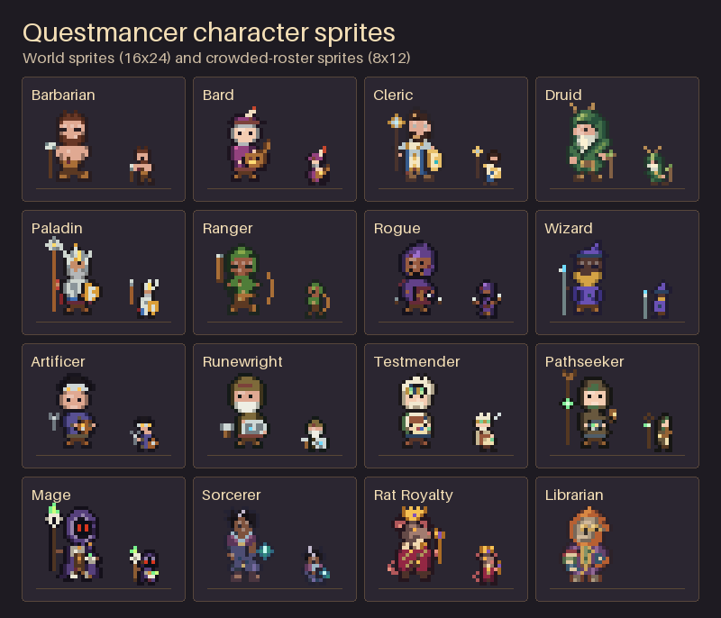
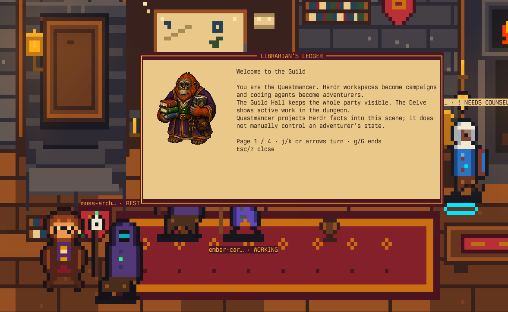
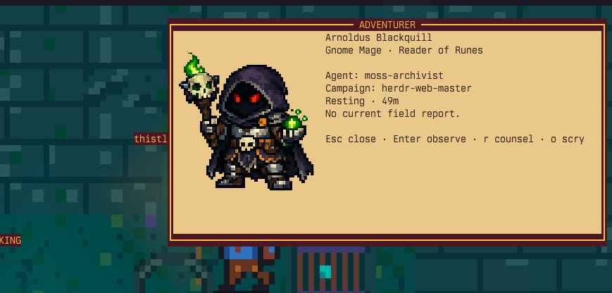
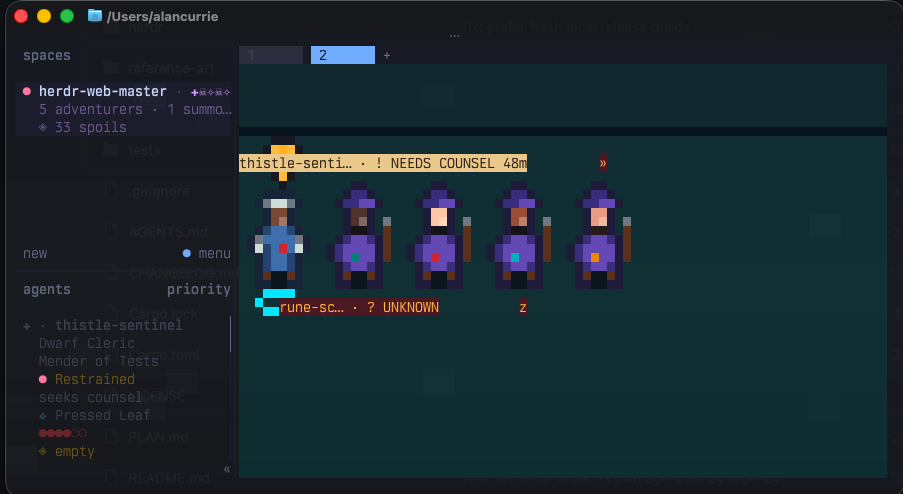
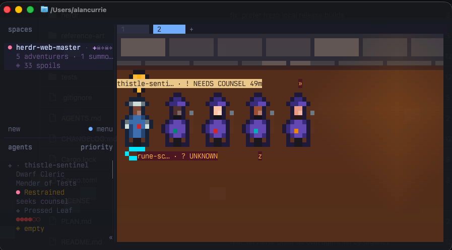
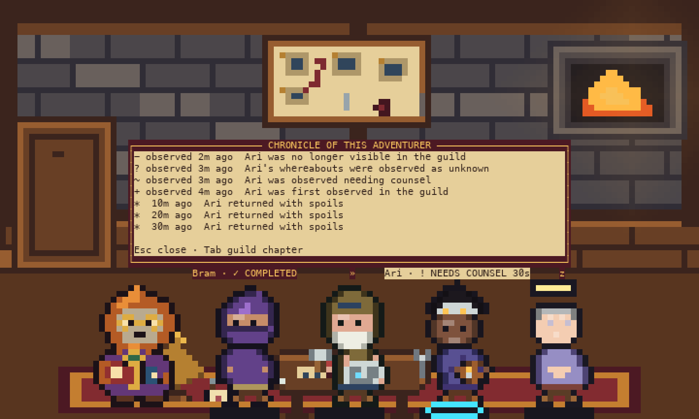
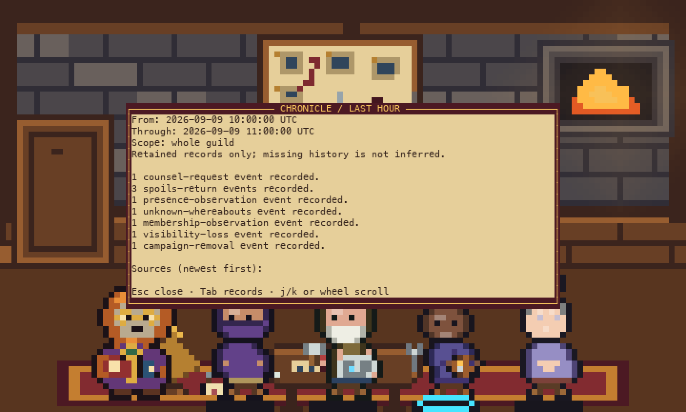

# Questmancer

> **What is best in code?**
>
> To crush your bugs.<br />
> See your agents driven before you.<br />
> Hear the lamentations of your token budget.



Questmancer is the Herdr plugin that turns a live coding-agent session into a
16-bit adventurers' guild. Herdr workspaces become **campaigns**, coding agents
become **adventurers**, and the room tells the truth about what is happening
now: working agents travel the Delve, blocked agents call for counsel, and
completed work returns with spoils.

[Open the live launch page](https://opsydyn.github.io/herdr-questmancer/) ·
[View the source on GitHub](https://github.com/opsydyn/herdr-questmancer)

The production interface is one RGB pixel world with two rooms:

- **Guild Hall** is the warm operational home for the whole party.
- **Delve** is the dungeon view of the same live Herdr state.

Both rooms retain the same selection and commands. An in-world selection rune
marks the selected adventurer; contextual parchment overlays handle counsel,
search and scrying without replacing the scene with a dashboard. A persistent
Librarian in the Guild Hall opens the fixed Librarian's Ledger handbook.

## Questmancer at a glance

- **An Inbox for work that needs your attention.** Press `b`, then `i` to
  triage summons across quests, or opt in to opening the Inbox at startup.
  Review a pinned Git candidate alongside its check receipt and optional Pi
  or Codex report. Explicit settlement records the reviewed revision.
- **Rooms that fit the party.** The Hall and Delve fit their complete rooms
  proportionally in compatible Kitty panes. Up to eleven adventurers retain
  detailed `16x24` sprites; 12–32 use authored `8x12` sprites in staggered seats,
  and 33–64 use denser seating. Identity keeps seats stable as presence changes.
  Profiles retain their full-size art and the fitted world beneath them.
- **Durable work you can author.** Create campaigns and quests, request and
  answer decisions, and register artifacts in an explicitly selected local
  store. The Quest Board and War Table keep work available independently of
  live agent sessions. Seen/deferred requests remain separate from answers.
- **Choose your adventurers' characters.** Press `e` to preview and select
  a character, including the opt-in Rat Royalty. The [native portrait lineup](docs/design/reviews/2026-11-18-native-portrait-alignment/lineup.png)
  uses the compact 16-bit style of Wizard and Mage. Authored half-block art
  provides the fallback on other terminals.
- **Current Herdr and Pi setup.** Herdr 0.9.4+ / protocol 22 compatibility,
  standard Kitty transport, and a qualified supported Pi integration recipe.
  Pi working/resting reports retain native session identity; resting alone
  never proves successful delivery or earns spoils.

Selection and counsel counts remain readable below fitted rooms. Other modal
parchments and unsupported graphics/geometry use responsive half-block output.
Parties above 64 use the explicit fallback. See
[automatic density](docs/manual-test/automatic-density.md),
[owned work authoring](docs/manual-test/owned-work-authoring.md) and the
[changelog](CHANGELOG.md).

## Two rooms, one party

| Guild Hall · the whole-party home | Delve · active work in connected chambers |
| --- | --- |
|  |  |

## Character sprite sheet



Press `e` in either room to preview a character for the selected adventurer.
See the [larger illustrated portraits](docs/design/reviews/2026-11-18-native-portrait-alignment/lineup.png) used in compatible terminals.

## Operational evidence

The fantasy language is a map to real state. These are the overlays and compact
compositions that keep the Guild Hall useful when the party gets busy.

| Librarian's Ledger | Adventurer profile |
| --- | --- |
|  |  |

| Compact party | Warm compact composition |
| --- | --- |
|  |  |

## Chronicle observations

`c` opens an adventurer's retained records; `Tab` requests a last-hour guild
chapter. Snapshot observations say what was seen locally, without inventing
missing transitions or awarding XP. Reconnects establish a quiet baseline.

| Adventurer records | Last-hour guild chapter |
| --- | --- |
|  |  |

Approved production render reconstructions, using fictional records; these are
not native terminal screenshots. [Review all six screens](docs/design/reviews/2026-09-09-chronicle-capture/README.md).

## Before the first quest

- Herdr `0.9.4` or newer, protocol `22` (qualified locally with `0.9.5`)
- Rust `1.90.0` for source builds (selected by `rust-toolchain.toml`)
- `jq` for the migration and guarded smoke-test recipes below
- `just` only for contributor shortcuts

## Summon the guild

```bash
herdr plugin install opsydyn/herdr-questmancer
herdr plugin action invoke opsydyn.questmancer.open
```

Herdr fetches the repository, reads `herdr-plugin.toml`, and runs the plugin's
own build step, which downloads the prebuilt binary for your platform and
verifies it against the release checksums. No clone, no Rust toolchain.

The installer selects the archives matching `herdr-plugin.toml` and verifies
`SHA256SUMS`. Release archives cover macOS and Linux on ARM64 and x86-64.
See the [release process](docs/release-process.md) for dated verification and
[source linking](#link-a-local-guild) when developing from this checkout.

For a GitHub-installed plugin, run `herdr plugin update opsydyn.questmancer`
and reopen the Questmancer pane to load the updated binary.

## Use with Pi

Install Pi and configure a working provider/model in Pi, then install Herdr's
supported integration:

```bash
herdr integration install pi
herdr integration status
```

Run interactive `pi` in a Herdr pane. For each Pi session already running,
enter `/reload` when it is ready; new sessions load the extension automatically.
Herdr owns recognition and status, and Questmancer displays the resulting
adventurer. The integration is not installed automatically by Questmancer.

The qualified combination is Herdr `0.9.5`, Pi `1.5.2` and integration `v9`.
A real `openai-codex/gpt-6.1-sol` turn produced stable native identity and
working → resting Chronicle records; reload/restart added no duplicate history.
The tested account rejected `gpt-5.5`, so choose a model your account supports.
An error can also return Pi to resting. The v9 hook has no explicit done report,
so this integration test does not establish completion or XP.

If Chronicle observations are withheld, inspect the adventurer's fresh Herdr
metadata: its terminal ID and all four session fields must be present. A plain
synthetic report without native session identity may remain unqualified.
See the [Pi activation guide](docs/manual-test/pi-integration.md) and
[qualification receipt](docs/reviews/2026-11-17-pi-integration/README.md).

## Build the binary (optional)

```bash
cargo install --path . --locked
```

From a local checkout, this builds the same binary and puts it on your `PATH`,
which is enough to run
`questmancer ui` directly. **It is not on its own an install of the plugin.**
`cargo install` places binaries and nothing else, so `herdr-plugin.toml` is not
where Herdr can find it, and `herdr/run.sh` looks for its binary inside the
plugin directory rather than on `PATH`. Link a checkout as below for the plugin
itself.

The crate carries the plugin sources and the pixel art it renders. Source
illustrations, screenshots and the launch site stay in the repository: they are
worth keeping in git and worth nothing to an install.

## Link a local guild

Questmancer currently supports source linking:

```bash
cargo build --release
herdr plugin link .
herdr plugin action invoke opsydyn.questmancer.open
```

The linked plugin runner resolves `target/release/questmancer`, then
`bin/questmancer`, then `target/debug/questmancer`. After a new
`cargo build --release`, reopen the Questmancer pane; relinking is unnecessary
while Herdr is still linked to this checkout.

### Cutting over an older development link

Close and unlink the previous local plugin before linking Questmancer. The
recipe discovers it by manifest name and local source:

```bash
previous_plugin=$(
  herdr plugin list --json |
    jq -r 'first(.result.plugins[] | select(.name == "webmaster" and .source.kind == "local")) | .plugin_id // empty'
)
if [[ -n $previous_plugin ]]; then
  herdr plugin action invoke "$previous_plugin.close" 2>/dev/null || true
  herdr plugin unlink "$previous_plugin"
fi
cargo build --release
herdr plugin link .
herdr plugin action invoke opsydyn.questmancer.open
```

An `unlink` error is meaningful: inspect `herdr plugin list` before continuing.

## Plugin actions

```text
opsydyn.questmancer.open
opsydyn.questmancer.close
opsydyn.questmancer.toggle
opsydyn.questmancer.guild
opsydyn.questmancer.delve
```

`open` restores and focuses the singleton Questmancer pane. `guild` and `delve`
open that pane in the requested room, or switch the existing pane. `toggle`
focuses Questmancer unless invoked from its own pane, where it closes it.

## Controls

| Key | Action |
|---|---|
| `1` / `F1` | Enter the Guild Hall |
| `2` / `F2` | Enter the Delve |
| `j` / `Down` | Select the next adventurer |
| `k` / `Up` | Select the previous adventurer |
| `g` / `G` | Select the first / last adventurer |
| `Enter` | Observe the selected adventurer's Herdr pane |
| `i` | Explain the selected adventurer's Herdr status and Chronicle coverage |
| `e` | Preview and choose the selected adventurer's character |
| `r` | Open the counsel parchment |
| `Space` | Acknowledge the selected unread summons locally |
| `s` | Set the selected summons aside for a while |
| `o` | Refresh the selected adventurer's recent output |
| `!` | Jump to the next human obligation or eligible summons |
| `Tab` | Move to the next campaign's party |
| `c` | Open the Chronicle |
| `b` | Open the Quest Board |
| `i` in Quest Board | Open the Quest Inbox |
| `v` in Quest Board | Request a revision review for the selected owned quest |
| `w` | Open or close the War Table |
| `a` in Quest Board | Open owned-work Actions and store setup |
| `Tab` in Chronicle | Last-hour guild chapter / records |
| `/` | Search the party and campaigns |
| `n` / `N` | Walk to the next / previous search match |
| `j`/`k`, wheel | Scroll an open Scrying or Chronicle parchment |
| `v` | Inspect spoils through Reviewr when available |
| `m` | Cycle motion: full, reduced, still |
| `u` | Switch between Unicode and ASCII glyphs |
| `p` | Switch between truecolour and 16 colours |
| `?` | Open or close the Librarian's Ledger |
| `Esc` | Dismiss the active parchment |
| `q` / `Ctrl-C` | Close Questmancer when no text parchment is open |

In the Hall or Delve, select an adventurer and press `e`. Use the arrow keys
or `j`/`k` to preview characters, including Rat Royalty. Press `Enter` to
save the choice or `Esc` to cancel. `End` moves to **Restore automatic**.
When the terminal supports native images, the picker shows the selected
character's illustration. Other terminals show its authored sprite.
The saved character follows the adventurer's Questmancer persona in both rooms.
The adventurer card and the first Librarian's Ledger (`?`) page also show
**[e] Character** in their controls.
Press `p` in the Ledger to name the party in both rooms. `Enter` saves,
`Esc` cancels, and clearing the draft with `Ctrl-U` then saving restores
the default. Party names and character choices require a writable profile.

`!` first cycles eligible durable human obligations, including work without a
live adventurer. It then falls back to adventurers waiting on a human, most urgent first: an
unanswered call for counsel, then one already seen but unresolved, then the
quieter summons, and within each rank whoever has waited longest. Deferred
summons are skipped until their snooze expires. When nobody is waiting the
selection stays put and Questmancer says so. While at least one adventurer is
waiting, the command ribbon carries the count.

Scrying and the Chronicle scroll with `j`/`k`, the arrow keys or the mouse
wheel. Scrying asks Herdr for `output_preview_lines` and the parchment shows
what fits, so scrolling is how the rest is reached.

Scrying follows the current selection and connection. A newer refresh replaces
any pending refresh; older results and failures cannot replace newer output.
Changing adventurer or reconnecting clears the previous preview and loads the
current selection again. Repeated refreshes keep one read in flight and the
latest pending read, while counsel proceeds independently. Exited adventurers
and Questmancer's managed pane cannot be read.

`s` sets a summons aside for fifteen minutes. The summons and the moment it
arrived both survive — the Hall still shows the adventurer needs counsel — but
`!` skips them until the time is up. Setting aside is session-scoped on
purpose: acknowledging with `Space` is written to durable state and survives a
restart, while a snooze is not, because the summons still needs answering and
reopening Questmancer is a fair moment to be reminded.

`m`, `u` and `p` change motion, glyphs and colour depth while running. Each
reports the setting it landed on and is written to durable state, so a change
made at runtime survives a restart without editing the configuration file.

At the authored `8x12` roster tier, both rooms give every live adventurer a
shared shape cue: a tool for working, lantern for counsel, Z for resting,
check for completed and question mark for unknown. These remain visible when
nameplates cannot fit. In full motion, fresh spoils shimmer beside the actor
for at most three seconds, then leave the completed cue. Reduced and still
modes keep that cue without a redraw timer. Newer presence or disconnection
interrupts the return, and reconnecting does not replay retained completion.

When native fitting is unavailable, the Guild Hall chooses canonical, compact, roster, single-adventurer vignette,
then status-only layouts according to size and party capacity. The Delve
uses its authored crop, with a whole-party roster below `100x56` RGB when it
fits at least `20x27`. The Librarian's clickable sprite appears in canonical
and compact Halls; `?` reaches its Ledger from every tier. See the
[current size contracts](PLAN.md#responsive-contracts) for exact thresholds.

Search reports how many adventurers matched and `n`/`N` walk them, wrapping.
Matches for adventurers who have since left the party are dropped rather than
selected.

`c` opens the Chronicle: the guild's own record of who joined, set out, asked
for counsel, returned with spoils, rested, departed, and which campaigns
closed. With an adventurer selected it shows that adventurer's history;
otherwise the whole guild's, newest first. `Esc` or `c` closes it. The
Chronicle is a reading surface — no key acts on the party while it is open.

Inside the Chronicle, `Tab` requests a guild chapter for the last hour, or
returns to the record list. The UTC window is fixed when requested. Chapters
count retained events, preserving recorded names, timestamps and source IDs
below the recap; scroll with `j`/`k` or the wheel. Retained history can be
incomplete. Accepted Herdr status reports and qualified snapshot differences feed
the Chronicle. New records label their local observation time; “observed” never
claims an exact upstream transition time. Startup, reconnect and subscription
resync establish quiet baselines, and chapters never fill unseen gaps. Missing
or ambiguous session identity also withholds inferred history. Source lines wrap
at the full chapter width; panes narrower than 80 columns clip them horizontally.
Widen the terminal to read all wrapped lines.

Snapshot observations, unknown whereabouts, membership visibility and campaign
removal earn no XP. A snapshot that first observes spoils does not gain a later
reward from matching metadata; a subsequent working-to-done status episode can
still earn the existing ten XP. A campaign-close hint requires snapshot
confirmation and never means successful delivery.

New Chronicle writes use a v2 JSONL envelope with captured source evidence and
immutable IDs. Existing flat v1 records retain their IDs, summaries and legacy
meaning; mixed replay does not rewrite the file or re-award standing. The
published 0.1.9 reader skips v2 records with diagnostics on downgrade. See the
[Chronicle capture acceptance recipe](docs/manual-test/chronicle-capture.md) for
current qualification limits.

Composed socket/file checks and isolated synthetic metadata observations pass;
see the [C3 receipt](docs/reviews/2026-09-09-chronicle-c3/README.md). The
[changed Chronicle screens](docs/design/reviews/2026-09-09-chronicle-capture/README.md)
were visually approved on 2026-09-09 and are included in `0.1.10`.

`Tab` moves the selection into the next campaign's party and wraps. With the
whole party on one campaign it stays put and says so.

A command ribbon along the bottom shows the main keys. It stays up until you
press something, then appears briefly whenever you act, so it helps a newcomer
without cluttering the room for anyone else.

A counsel draft is kept when you close the parchment with `Esc`, and `r`
takes it up again. Drafts belong to the adventurer they were written for, so
switching selection never puts somebody else's half-written counsel in front
of you. Sending clears the draft. A send continues to own its draft if the
parchment is closed while Herdr is replying, so a late result still settles the
right operation.

Counsel and search accept ordinary text. `Enter` submits, `Ctrl-U` clears, and
`Esc` cancels. A definite text rejection keeps an editable draft. If text
delivery cannot be confirmed, `Enter` observes the adventurer and `Esc`
explicitly abandons the attempt; Questmancer never resends uncertain text. If
the text was accepted but Enter failed, retry sends Enter only. Questmancer
never selects, focuses, reads, or counsels its own managed pane.

The persistent Librarian is a non-agent Guild Hall character. Click him—or
press `?` anywhere—to open the same five-page handbook. Use left/right to page
through Welcome, Reading the Party, Questmancer's Keyring, The Guild's Standing
and Safe Chronicle;
`Esc` closes it. The Librarian cannot receive counsel, focus or output commands.

The Keyring page is generated from the binding table itself rather than
written by hand, and a test sweeps every key the input handler accepts and
fails on any action the Keyring does not describe. The table above and the
Keyring cannot drift apart from what the keys actually do.

Herdr and the coding-agent CLI remain authoritative. Questmancer does not
manually steer sprites: their identity, location, pose and attention effects
derive from Herdr state. The only text sent to an agent from Questmancer is
explicit counsel composed with `r`; all other sprite behaviour is projection.

## Configuration

Locate the user-owned configuration directory with:

```bash
herdr plugin config-dir opsydyn.questmancer
```

Create `config.toml` there when defaults are not sufficient:

```toml
default_view = "guild"            # guild | delve
inbox_on_start = false            # open the Quest Inbox on ordinary launches
motion = "full"                   # full | reduced | none
character_set = "unicode"         # unicode | ascii
color_mode = "xterm256"           # xterm256 | ansi16
output_preview_lines = 80          # 10..=500
chronicle_max_entries = 500        # 50..=10000
reviewr_action = "persiyanov.reviewr.open"
show_elapsed_time = true
sidebar_urgency_order = false      # let Herdr order its agent list by urgency
```

Invalid configuration is reported visibly and safe defaults are used. Display
compatibility settings remain accepted while the RGB scene is the sole
production renderer.

### Optional Herdr sidebar marginalia

Questmancer can add a small, truthful marginal note to Herdr's own sidebar.
This is opt-in: add rows to your existing user-owned Herdr `config.toml`; the
plugin never rewrites global Herdr configuration or semantic agent state.

```toml
[ui.sidebar.agents]
rows = [
  ["state_icon", "workspace", "tab"],
  [
    { token = "agent", fg = "#cdd6f4", bold = true, dim = false },
    { token = "$quest_role", fg = "#9399b2", dim = false },
    { token = "$quest_omen", fg = "#9399b2", dim = false },
  ],
]

[ui.sidebar.spaces]
rows = [
  ["state_icon", "workspace"],
  ["branch", "git_status", { token = "$quest_campaign", fg = "#9399b2", dim = false }],
]
```

Herdr renders sidebar rows faint unless an element sets `dim = false`, and
unstyled text uses a muted UI colour rather than the theme foreground, so a
bare token lands around 1.9:1 against a dark background. The explicit `fg` and
`dim = false` above are what make the rows readable;
[the character sheet](docs/design/questmancer-sidebar-character-sheet.md)
measures this in detail.

`$quest_role` is the adventurer's stable ancestry and class, `$quest_omen` is
the current presence in guild language, and `$quest_campaign` is the live
party and summons roll-up. The feature uses Herdr's display-only metadata
channel, so it never changes an agent title, status label, focus or task.

`rows` replaces the corresponding Herdr sidebar rows: merge this example with
any existing sidebar customisation, then run `herdr config check` and reload
the viewing client configuration using its reload-config shortcut. See the
[conditional sidebar proposal](docs/design/questmancer-sidebar-09.md) for 0.9
state and waiting-time emphasis, and the
[class-sigil recipe](docs/design/questmancer-sidebar-class-sigils.md) for readable
class colours beside adventurer names. Questmancer
does not use `rows_by_agent`; its dynamic personas remain presentation data.

### Letting Herdr sort its own agent list by urgency

Set `sidebar_urgency_order = true` in Questmancer's configuration and Herdr's
sidebar, mobile and keybind navigation order lead with whichever adventurer
needs a human — the same ranking `!` uses inside Questmancer. It is off by
default because it changes shared Herdr UI, it sorts without ever filtering so
no agent is hidden, and it is released when Questmancer closes.

Available within the current Herdr `0.9.4` / protocol `22` requirement.

## The guild's standing

Questmancer keeps one experience score for this install — not one per
adventurer. Parties change with every session; the guild is the thing with
continuity, so the guild is what keeps the score.

Standing is shown as a badge in the top-right corner of the room and in full on
the Guild's Standing page of the Librarian's Ledger (`?`). It is earned by work
confirmed by current pane metadata: spoils returned. Snapshot observations and
campaign removal earn no XP. Previously saved standing is retained. An adventurer arriving, setting out or resting is worth nothing, and so
is an adventurer asking for counsel — that records somebody getting stuck, and
paying for it would reward agents for blocking.

The score only ever climbs, is stored rather than recomputed from the
Chronicle, and unlocks nothing. It is a flourish, not an instrument: a tool
that withheld features until you had used it enough would be a worse tool.

## Local state and privacy

Questmancer is local-only at runtime. It has no telemetry, cloud sync or network
service; runtime communication stays on Herdr's local socket.

| Path | Purpose |
|---|---|
| `$HERDR_PLUGIN_CONFIG_DIR/config.toml` | User-owned read-only configuration |
| `$HERDR_PLUGIN_STATE_DIR/runtime.json` | Ephemeral singleton-pane registration |
| `$HERDR_PLUGIN_STATE_DIR/state.json` | Atomic v2 local intent, party name, persona assignments and optional owned-store pin |
| `$HERDR_PLUGIN_STATE_DIR/state.lock` | Advisory writer lease shared by launches of this profile |
| `$HERDR_PLUGIN_STATE_DIR/chronicle.jsonl` | Append-only semantic event history |
| `$HERDR_PLUGIN_STATE_DIR/work-state.json` | Acknowledged source projection cache, never work authority |
| Explicitly selected `owned-work.json` | Authoritative owned records, answers and bounded receipts; sibling writer lock |

The state store does not copy Herdr-owned output or topology. The Chronicle file
has no automatic size bound and grows until the user removes it.

## Developer Storybook

The feature-gated Storybook renders the production scene engine without Herdr,
agent processes or persistent state:

```bash
just storybook
```

It contains 92 fixed production and comparison stories, with each asset owned
once and additional variants sharing the Quest Board and War Table assets.

The `interaction.quest-inbox` study compares current, stale and pending review
evidence. Open it directly with `cargo run --features storybook --bin
questmancer-storybook -- --story interaction.quest-inbox --inspect --no-graphics`.
See the [Quest Inbox walkthrough](docs/reviews/2026-11-18-quest-inbox/README.md).

The world studies `world.delve-walk`, `world.delve-materials` and
`world.guild-materials` preview changes in the production scene engine.
In Delve Walk inspection, Space replays the 1.5-second route and `m` cycles
motion. Native fit shows the complete route in compact panes.

- two worlds: Guild Hall and Delve;
- twenty-one asset galleries: classic world and portrait masters, Barbarian, Wizard,
  Ranger, Bard, Artificer, Testmender, Cleric, Paladin, Druid, Rogue, Pathseeker,
  Runewright, Mage and Sorcerer poses, persona palettes, five roster
  silhouette families, custom
  class masters, Goblin sprites and Librarian sprites;
- fourteen native class cards: Artificer, Barbarian, Bard, Cleric, Druid, Mage,
  Paladin, Pathseeker, Ranger, Rogue, Runewright, Sorcerer, Testmender and Wizard;
- Rat Royalty at three sprite scales and separate reserved Goblin and Orc cards;
- twenty-eight interactions: selected adventurer, character picker, counsel, search, scrying, Librarian's
  Ledger, narrow parchment, and seven Quest Board states (populated, empty,
  offline, deferred, resolved, narrow and departed worker), plus six War Table
  states (populated, narrow, empty, offline, cyclic and large), and eight owned
  authoring states (actions, empty campaign, answer, narrow answer, view pending,
  indeterminate outcome, answered detail and below minimum).

Eight experimental capacity studies compare seven full/small adventurers and
24/32 small adventurers in both rooms. See
[`docs/design/reviews/2026-11-17-party-capacity/README.md`](docs/design/reviews/2026-11-17-party-capacity/README.md)
for images and direct comparison commands. The eight experiments keep their
forced comparison sizes. Production now chooses size tiers automatically in
both native fitted rooms: 16x24 masters through eleven adventurers, authored
8x12 staggered seats for 12–32 and denser 8x12 seats for 33–64. Full-size profiles
remain; graphics/geometry and bounded-capacity fallbacks are explicit. The
`world.guild-fit-auto` and `world.delve-fit-auto` stories exercise the production
32-person fit. See [the native review checklist](docs/manual-test/automatic-density.md).

`world.guild-fit-casters` and `world.delve-fit-casters` show all fourteen classes
in the same party, with named selections and full-size profiles. All fourteen
classes have dedicated `8x12` silhouettes. See the
[full class art review](docs/reviews/2026-11-17-full-class-art/README.md).

Use `j`/`k` or Up/Down within a category, `h`/`l` or Left/Right to change
category, `Enter` to inspect, `Esc` to return, and `q` to exit. Run its
focused checks with `just storybook-test`. The Storybook header reports
`native Kitty`, `native Sixel`, `native iTerm2`, or `authored sprite fallback`
so the active card rendering path is explicit.

Wizard, Ranger and Barbarian now use the approved stocky proportions and
class-specific book, map and tool rituals. Working uses two 500 ms frames;
a fresh blocked episode raises the counsel signal once for 600 ms, then waits
still. Returned spoils are placed after one second and become quiet by three
seconds. Reduced/still motion preserves a static meaningful pose. Counsel
confirmation briefly seals the existing notice; only a later Herdr presence
update resumes work. See the [production pilot review](docs/design/reviews/2026-09-05-party-pilot/README.md)
for pose sheets and fixture playback. Their card fallbacks now reuse those
exact personalised world sprites inside the existing portrait canvas; see the
[card comparison](docs/design/reviews/2026-09-05-card-fallbacks/README.md).

Bard, Artificer and Testmender now share that bounded timing with their own
approved lute, brass-device and needlework rituals. Their saved persona
colours still apply to every pose. Their card fallbacks now centre those same
sprites at native size, matching the room without changing the card canvas.
See the
[card comparison](docs/design/reviews/2026-09-08-tool-card-fallbacks/README.md)
and the [tool ritual production review](docs/design/reviews/2026-09-08-tool-ritual-production/README.md)
for current room playback and all three Storybook pose galleries.

Cleric, Paladin and Druid now share those ritual paths with their approved
book, shield and living-staff frames. Their production visuals were approved.
Their card fallbacks now reuse those same personalised sprites at native size;
see the [card comparison](docs/design/reviews/2026-09-08-cleric-paladin-druid-card-fallbacks/README.md)
for the approved card visual review. See
the [production review](docs/design/reviews/2026-09-08-cleric-paladin-druid-production/README.md)
for the three new pose galleries and both rooms.

Rogue, Pathseeker and Runewright now use their approved practice-lock, compass
and rune-stone gestures through the shared ritual timing and persona paths.
Their [production review](docs/design/reviews/2026-09-08-rogue-pathseeker-runewright-production/README.md)
includes three new pose galleries and both rooms; production visuals were
approved on 2026-09-08. Their card fallbacks now centre the same personalised
world sprites at native size. The [card comparison](docs/design/reviews/2026-09-08-rogue-pathseeker-runewright-card-fallbacks/README.md)
was visually approved on 2026-09-08. The final [Mage and Sorcerer storyboard](docs/design/reviews/2026-09-08-mage-sorcerer-storyboard/README.md)
was visually approved. Its green-censer and silver-focus gestures now use the
shared timing and persona paths, completing rituals for all fourteen classes.
The Mage/Sorcerer pose galleries originally brought Storybook to 45 stories. Their
[production review](docs/design/reviews/2026-09-08-mage-sorcerer-production/README.md)
was visually approved on 2026-09-08. Their card fallbacks now centre the same
personalised world sprites at native size, completing continuity for all
fourteen classes. The [final card comparison](docs/design/reviews/2026-09-08-mage-sorcerer-card-fallbacks/README.md)
was visually approved on 2026-09-08.
See the [complete candidate review](docs/reviews/2026-09-08-party-candidate/README.md)
for the approval index, and the [published 0.1.9 record](docs/reviews/2026-09-08-published-release/README.md)
for clean qualification, archive checks and the actual installer result.

The Storybook uses fixed fixture time and shows authored pose galleries. Its
world stories do not play a live animation timeline; the review GIFs sample
the production renderer at explicit times.

Native Kitty portraits inside a Herdr-managed pane also require Herdr's
native Kitty transport (enabled by default):

```toml
[terminal]
kitty_graphics = true
```

The legacy `experimental.kitty_graphics` key is still accepted; an explicit
false remains respected. Validate changes with `herdr config check` and follow
the transport refresh procedure linked below. Without the bridge,
Questmancer deliberately uses its authored RGB sprite; the outer terminal being
Kitty-compatible is not sufficient on its own.

See [Native portrait rendering through Herdr](docs/troubleshooting/native-portrait-rendering.md)
for the complete failure analysis, recovery sequence and guarded smoke test.

Herdr 0.9.4 retains protocol 22. Since 0.9.2, `pane.graphics.*` is removed;
Questmancer now uses the standard terminal capability query and Kitty output
without a socket geometry workaround. Lost event history triggers a reconnect
and a quiet baseline. See [0.9.4 compatibility and opportunities](docs/reviews/2026-10-14-herdr-094/README.md).

For a GitHub-installed plugin, `herdr plugin update opsydyn.questmancer` fetches
the published version; reopen Questmancer afterward to use it. Locally linked
checkouts are skipped: rebuild with `cargo build --release` and reopen the pane.
Version 0.2.0 includes these compatibility and responsive-scene changes.

## Guarded live smoke test

Use a disposable plain Herdr pane. Never target a Codex pane, the Questmancer
pane, or another agent-owned pane.

```bash
PANE_ID=$(herdr pane current | jq -r '.result.pane.pane_id')
SOURCE_ID="questmancer-smoke-$(date +%s)-$$-$RANDOM"

herdr pane report-agent "$PANE_ID" \
  --source "$SOURCE_ID" \
  --agent smoke-adventurer \
  --state working \
  --message "mapping the dungeon" \
  --seq 1

herdr pane report-agent "$PANE_ID" \
  --source "$SOURCE_ID" \
  --agent smoke-adventurer \
  --state blocked \
  --message "needs counsel" \
  --seq 2

herdr pane release-agent "$PANE_ID" \
  --source "$SOURCE_ID" \
  --agent smoke-adventurer \
  --seq 3
```

Herdr `0.9.4` can report `idle`, `working`, `blocked` and `unknown`; it cannot
synthesize an explicit `done` transition. Do not claim live completion-state
acceptance from this recipe.

The full environment-preserving procedure is in the
[production manual acceptance guide](docs/manual-test/questmancer-scene-preview.md).
Visual decisions and unreviewed states are recorded separately in the
[cutover evidence ledger](docs/superpowers/reviews/2026-07-17-scene-first-cutover.md).

## Releasing

`release-plz` proposes version bumps and tags merged release commits; changelog
entries are written by hand. The release-pr workflow runs
`scripts/sync-plugin-version.sh` automatically on its release branch to keep
`Cargo.toml` and `herdr-plugin.toml` aligned. The tagged release workflow builds
four archives and `SHA256SUMS`. See [the release process](docs/release-process.md)
for publication status, token requirements and dispatch recovery.

## Contributor checks

```bash
cargo fmt --all --check
cargo clippy --all-targets --all-features -- -D warnings
cargo test --all-targets --all-features
PROPTEST_CASES=4096 cargo test --test scene_pixel_properties --test scene_stage_properties
bash tests/scripts.sh
bash -n herdr/install.sh herdr/run.sh herdr/control.sh
cargo build --release
```

For an offline production run, use `just run guild` or `just run delve`.

## Uninstall a local link

Close Questmancer first, then remove only this plugin link:

```bash
herdr plugin action invoke opsydyn.questmancer.close
herdr plugin unlink opsydyn.questmancer
```

Do not stop Herdr to uninstall a plugin.

```text
best viewed with ratatui
80x24 minimum
the guild hall is always open
```

### Optional adventurer line inside terminal panes

Paired development builds of Herdr and Questmancer can show a small adventurer
sprite, live name, class and condition in a reserved row above terminal content.
This is an opt-in Herdr capability, not part of the published Herdr 0.9.4 API:

```toml
[ui]
pane_viewport_header = true

[terminal]
kitty_graphics = true
```

Questmancer probes `pane.viewport_header.info` before publishing. An older or
disabled server leaves this feature inactive. The row remains text-only when
native graphics cannot fit or are disabled; the managed Questmancer pane never
receives an adventurer annotation. Only connected, unambiguous terminal/session
identities qualify. These headers are ephemeral: replacement, departure and
shutdown clear them, with a 30-second server lease covering a lost publisher.
They never enter terminal output, saved state, pane titles or sidebar settings.
See [the guarded procedure](docs/manual-test/questmancer-scene-preview.md#pane-adventurer-line-repair-check).

## Durable work and the Quest Board

`b` opens a contextual Quest Board over the current world. Wide inventory titles
wrap onto indented continuation lines; selection follows the wrapped row heights. `!` reaches the next
human obligation, including work with no live adventurer, then falls back to the
existing summons. In the Board, `j/k` or Tab/Shift-Tab select work; Up/Down or wheel
scroll details. Space marks seen and `s` sets an obligation aside for 15 minutes.
These actions are saved locally and never answer or resolve a source request.
Enter observes only a verified live adventurer binding; Esc closes the Board.

Work sources own campaign objectives, quest lifecycle and dependencies, requests,
assignments and spoils. Questmancer displays their literal facts and freshness.
`work-state.json` caches accepted work checkpoints and local intent separately
from `state.json` and the Chronicle. Restored facts are unverified until a source
baseline confirms them. Invalid or future cache files are protected from writes.
Live Herdr topology, terminal output and session/pane bindings are never cached.

M1 uses a deterministic authentication campaign in tests and Storybook. Normal
startup installs no synthetic campaign. Create/Open an owned store through Actions
to supply your own work, or explicitly configure the optional source below. The
[implementation receipt and production review pack](docs/reviews/2026-09-30-durable-obligations/README.md)
separate engineering checks, the 2026-09-30 production visual approval after
the truncation repair, and unperformed native-terminal acceptance. M1 is complete
for its fixture-backed scope and included in 0.2.0; native-terminal acceptance
remains separate.


## Quest Inbox

Open the Quest Board with `b`, then press `i` for the Inbox. The queue groups
summons by quest and keeps campaign-wide summons visible. Enter opens the
selected details, and Tab cycles the quest's summons and review history. Space
marks an item seen. `s` defers it for 15 minutes or restores it to the due queue.

Set `inbox_on_start = true` in Questmancer's `config.toml` to open the Inbox
over your usual room. Esc returns to the room and `b` opens the Board. The
Guild Hall and Delve launch actions and explicit `--view` launches go directly
to the requested room. Use `a` to reach store setup from an empty Inbox.

Select an owned quest on the Board and press `v` to request a review of two
pinned local Git commits. An open review shows its acceptance criterion,
changed files, any Pi or Codex report supplied with the request and any
registered PR link. Press `c` to import the chosen runner's receipt. Press
`x` to confirm settlement once the pinned change summary is available and the
required check has passed for that candidate. The review and its outcome
survive a restart. See the [local review walkthrough](docs/manual-test/quest-inbox.md).
The first saved revision review updates the owned store to v2. Keep a copy
of the store before starting a revision review if you may need to downgrade.

## War Table

`w` opens a contextual campaign map over the Hall or Delve, or follows the
selected Board work into its campaign. Links point from prerequisite to dependent;
state and source-open human requests remain separate. `j/k` selects quests,
Tab/Shift-Tab changes campaigns, Up/Down or wheel reads the complete details,
`b` opens the selected quest in the Board, and Esc or `w` closes. Enter observes
only a verified adventurer binding; `!` keeps the existing attention policy.

Cards show source lifecycle, historical ownership, open human requests (`?`) and
human review requests (`R`). Complete counts are source quest facts, not delivery
or merge evidence. Source freshness stays visible; unknown artifact validation
stays unknown. Cycles and campaigns too large for the map use a labelled inventory
that follows selection. Smaller panes retain the selected-work parchment; tiny
panes show status only. Full names, dependencies, requests and artifacts are
reachable in details even when a map label ends in an explicit `...` marker.

The opt-in Herdr Projects reader below supplies a partial record inventory;
native/live-source acceptance remains separate from the fixture proof.
[Plan](docs/plans/2026-09-30-war-table.md) and
[engineering receipt and production review](docs/reviews/2026-09-30-war-table/README.md)
record the M2 gates. M2 is engineering-qualified and production-visually approved
on 2026-09-30, complete within its fixture-backed scope and included in 0.2.0. Native
terminal and live-source acceptance remain separate. It does not alter source
work, persistence formats or awards.

## Owned work authoring

The agreed direction is an authoritative project/work backend we own, with
Questmancer as its human interface and Herdr providing execution. Its backend owns
campaigns, quests, decision answers and artifact registrations through explicit
commands. The existing Board/Table and work reducer remain projections; the work
cache and Chronicle do not become authoritative stores.

The [design contract](docs/design/questmancer-owned-work.md) and
[first milestone plan](docs/plans/2026-10-01-owned-work.md) cover backend proof,
then minimal authoring and restart. L1a implements five commands, a separate locked
`owned-work.json` store and Complete source projection behind explicit library
calls. L1b now connects a serial owner to startup and Board parchment forms.
Open the Board with `b`, then Actions with `a`. Explicitly Create/Open a store,
choose an owned campaign (including empty campaigns), and create a campaign/quest,
request/answer a decision or register an artifact. Decisions keeps open and
answered records. Answers are read from the checked owner; seen/defer is not Answer.

Tab moves focus, Enter activates a focused button or inserts a multiline newline,
Up/Down or wheel reads context, and bracketed paste is literal and bounded. Esc keeps
one draft while returning to Actions/Board; Discard clears it and quit loses it.
Below 28 columns or 12 rows, resize before submitting. Saved/view pending and uncertain
outcomes have separate recovery actions; retrying a view cannot duplicate a command.

The remembered path/source pin is local state v2; legacy v1 intent migrates. No pin
creates no store, and missing/protected/replaced stores are never replaced implicitly.
See the [operating recipe](docs/manual-test/owned-work-authoring.md),
[implementation and review receipt](docs/reviews/2026-10-03-owned-authoring/README.md),
[backend receipt](docs/reviews/2026-10-03-owned-work-backend/README.md) and
[form design](docs/design/questmancer-owned-authoring.md). Engineering/automated PTY
qualification is separate from native use and real Herdr use. Included in 0.2.0,
this first milestone provides local authoring, not agent delegation. The user
approved the [production form images](docs/reviews/2026-10-03-owned-authoring/visual-approval.md);
Computer Use refuses Ghostty access, so the [native trial](docs/plans/2026-10-03-owned-authoring-native.md)
is prepared for human execution and remains unperformed.
Projects and Firstmate are design references; neither needs to be installed.
Further Projects qualification is parked and its existing optional adapter retained.

## Herdr Projects inventory (optional, parked qualification)

A pinned read-only snapshot exporter and strict decoder are engineering-qualified
against synthetic source trees. An explicit opt-in runtime source now feeds the
existing Board/Table through acknowledged storage. Every export retains Partial coverage and
explicit unsupported native identity, request and binding capabilities.
[Contract](docs/design/herdr-projects-snapshot-contract.md),
[receipt](docs/reviews/2026-09-30-herdr-projects-exporter/README.md) and
[M3 plan](docs/plans/2026-09-30-herdr-projects-adapter.md) record the limits.
The subsequent [identity/coverage contract](docs/design/herdr-projects-identity-coverage.md)
selects explicit registration/retained records with locked partial observations
and omission guards. The user subsequently approved the mapper/cache proof.
It now maps literal campaign/thread facts into neutral work states and publishes
the projection plus typed identity checkpoint in one v2 cache, preserving valid
v1 work and local intent. Its production visuals were subsequently approved. See the
[mapper receipt and production review images](docs/reviews/2026-09-30-herdr-projects-mapper/README.md).
Native identity, structured summons, dependencies and live bindings remain
unsupported. The runtime owns a read-only directory lease, one capture/delivery
at a time, five-second healthy polling, bounded retries and cooperative shutdown.
Identity failures latch until owner reconciliation; transient failures retain work.
Unchanged observations do not write or redraw. Configuration is disabled by default;
see the [selection and operating guide](docs/manual-test/herdr-projects-inventory.md)
and [runtime qualification receipt](docs/reviews/2026-09-30-herdr-projects-runtime/README.md).
The [diagnostic images are approved](docs/reviews/2026-09-30-herdr-projects-runtime/visual-approval.md);
M3a.3 is included in 0.2.0 within its synthetic inventory scope and remains
disabled by default, with further qualification parked.
Only disposable source trees have been exercised. Installed-source compatibility,
native interaction and live Herdr remain unperformed. The next
[bounded acceptance plan](docs/plans/2026-09-30-herdr-projects-acceptance.md)
was promoted. Its [prerequisite audit](docs/reviews/2026-09-30-herdr-projects-acceptance/README.md)
found no Herdr Projects on PATH or in local registration, installed Herdr 0.9.0
below the upstream minimum, and automatic ticker startup in normal thread creation.
No operational trial was started. Accumulated work is committed at `4923a05`;
the [upstream-writer fixture proposal](docs/plans/2026-09-30-herdr-projects-writer-fixtures.md)
and further acceptance/M3b work are parked following the owned-work decision.
The next gate is separately qualified native use; production form images are approved.
L2 lifecycle work needs its own bounded plan and promotion.
