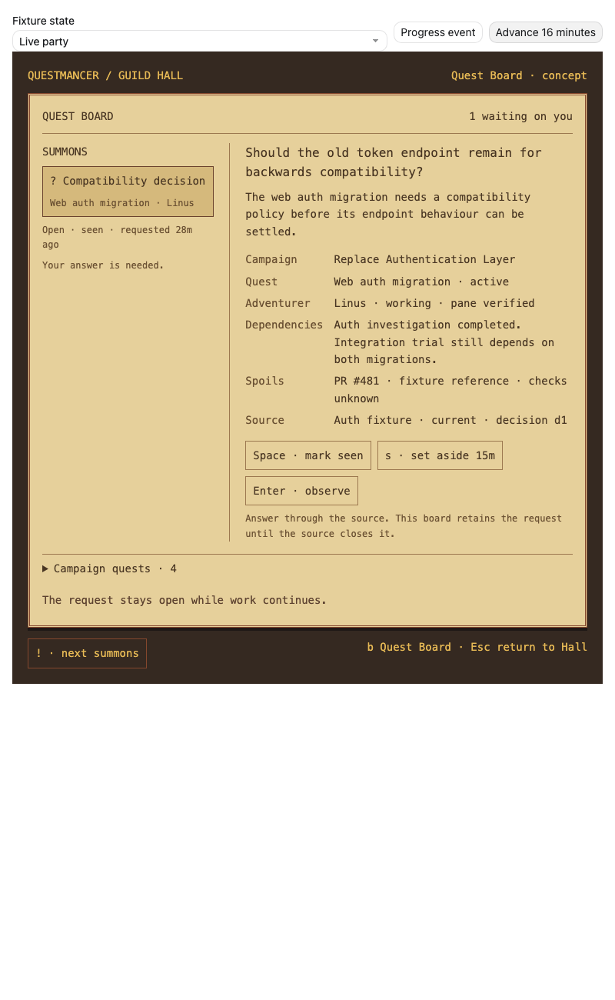

# Quest Board interaction concept — 2026-09-30

Architecture, roadmap and first-slice plan approved by the user on 2026-09-30.
The user approved this visual/interaction concept on 2026-09-30 and authorised
M1 implementation. This approval covers the concept; the
[production review pack](../../../reviews/2026-09-30-durable-obligations/README.md)
records implementation evidence and its separate visual gate.

## Proposed interaction

The Quest Board is a contextual parchment over the existing Guild Hall. `b`
opens it even when nobody needs attention; this key is unassigned in the inspected
current input map. `!` reaches the next human obligation or legacy summons.
The queue names the obligation first; selected details show its literal request,
campaign, quest, adventurer binding, dependencies, spoils and source freshness.

Space marks an obligation seen; it remains eligible. `s` sets it aside for
15 minutes, retaining its request and durable deadline. Enter observes only a
verified live binding. Answer delivery remains with the source in M1. Escape
returns to the Hall. Existing counsel drafts and Hall selection must survive.
Campaign quests remain accessible when obligations are deferred or resolved.

The wide concept places summons beside selected details. Narrow views stack
those sections and wrap the full request. Actual terminal implementation must
respect its row budget: a compact queue/summary followed by a scrollable detail
parchment, with keyboard access to every field/action. This browser reflow is
an interaction direction, not evidence of a 40-column Ratatui implementation.
No world/station art is added by this concept.

## Review states

- [Adventurer exited](worker-exited.png): assignment/request retained; observe disabled.
- [Restart](restart.png): cached source facts awaiting verification; local intent retained.
- [Source unavailable](offline.png): last-known obligations remain visible.
- [Source resolved](resolved.png): obligation leaves the queue; quest stays active.
- [No work source](empty.png): Quest Board remains reachable; legacy Hall continues.
- [Narrow layout](narrow.png) and [320px minimum](minimum.png): browser wrapping/stacking.

The interactive preview's state selector represents fictional source scenarios.
Progress and virtual elapsed time exercise attention behaviour. Its restart state
simulates restored intent in memory; it does not write/replay `work-state.json`.
PR #481 is an illustrative reference, not a real linked PR. No button sends
counsel, observes a real pane, opens a URL or resolves an external decision.

## Evidence and reproducibility

[Verification](verification.json) records successful browser checks for progress,
exit, seen/defer, simulated restart, expiry, explicit resolution, empty inventory
and wrapping at 320/360/800px. Browser captures were visually inspected at 800px
and 320px. These are concept checks, not reducer, persistence, production render,
native terminal or live source acceptance. Existing runtime code was not edited.

The [concept fragment](concept.html) retains the exact interactive design. The
[check script](check-concept.cjs) uses the available bundled Playwright and an
owned headless Chromium instance against the local wrapper at
`/tmp/quest-board-preview.html`. The visualization skill's `scripts/render.py`
wraps the fragment for local review. No app page or service was deployed.

Chromium initially could not register its macOS Mach port inside the sandbox;
the approved local browser check succeeded after sandbox escalation. This was a
browser-launch constraint, not a Questmancer failure. No shared Herdr server or
plugin registration was touched.

## P0 outcome

The user approved this interaction direction on 2026-09-30. Production request
placement, narrow scrolling, seen/resolved wording and disabled observation are
now reviewable in the separate M1 pack. Concept approval does not establish
production or native terminal acceptance.
