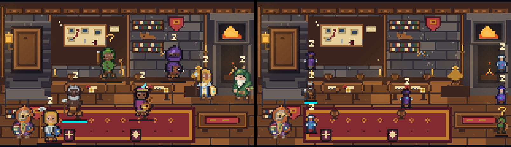
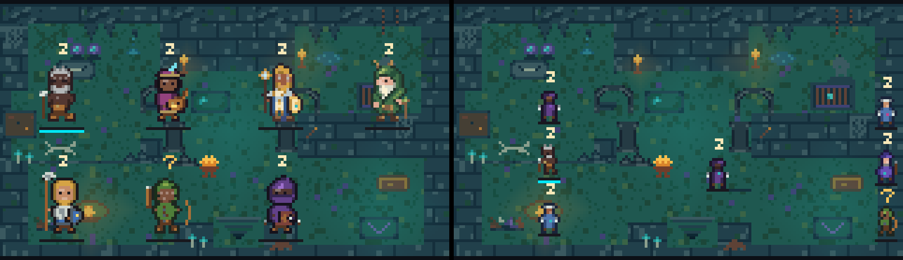
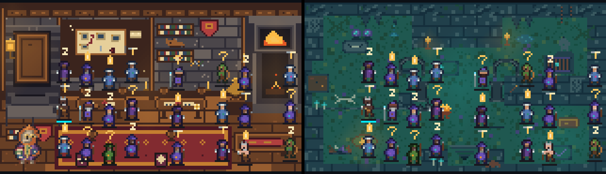

# Larger-party UX comparison — 2026-11-17

| Work receipt | Result |
| --- | --- |
| result | complete |
| claim | A working isolated Storybook comparison fits up to 32 authored small adventurers in either complete room, with individual click targets, state cues and full-size profiles. Production is unchanged. |
| evidence | Eight interactive stories, 24 source renders at three sizes, targeted regression tests, executable PTY receipts and the verification record in this directory. |
| remaining uncertainty | Native Ghostty appearance and unassisted identity/attention recognition need human review. Density thresholds, source-station semantics and support above 32 are not implemented. |
| next | Needs review: compare the seven-person sizes and inspect 24/32 in both rooms; then choose the preferred density and spatial grouping before production integration. |

**Pursue adaptive density with selected detail.** The user needs to keep a larger
party visible, identify who needs attention and inspect one adventurer without
the whole room changing scale. Existing screenshots and current-source exports
establish the failure: the Hall can abandon fitting and the Delve can regroup
everyone into a single row. A comfortable replacement size is still a product
choice. The bounded initial target here is 24–32, pending the optional party-size
preference question.

The proposed production UX would keep the complete room fitted, switch to
smaller authored map sprites when needed, retain clear state cues, and show a
readable selected identity plus the existing full-size profile. Larger parties
would need campaign grouping or room navigation rather than indefinite shrinking.
Those behaviors are recommendations, not implemented production features.

## Seven adventurers: compare size before increasing count

Left: current 16x24 authored masters in experimental distributed seating.
Right: existing authored 8x12 sprites with the same seven resting/unknown facts.
These are concept renders from code, not screenshots or production acceptance.





## Twenty-four adventurers in each complete room

Hall on the left, Delve on the right. Both use existing 8x12 art with distinct
tool/lantern/Z/question cues. Seats spread occupancy across the room's depth
with staggered positions, instead of making one crowded station relocate the
whole party. They are neutral study seats, not source-station assignments.



The same candidate contains all 32 actors in
[the Hall](hall-32-Small-120x34.png) and
[the Delve](delve-32-Small-120x34.png). No master is downsampled. The small artwork
is a separate authored set with less class detail; some classes share silhouette
families. Do not treat that art compromise as approved. The full-size world
masters and profile portraits remain available in their existing roles.

## Try the working comparison

```sh
cargo build --features storybook --bin questmancer-storybook
./target/debug/questmancer-storybook --story world.capacity-hall-24-small --inspect
```

Replace the ID with `world.capacity-delve-24-small` for the Delve, or use the
following combinations in either room:

| Party | Hall suffix | Delve suffix |
| --- | --- | --- |
| Seven full-size | `hall-7-large` | `delve-7-large` |
| Seven small | `hall-7-small` | `delve-7-small` |
| Twenty-four small | `hall-24-small` | `delve-24-small` |
| Thirty-two small | `hall-32-small` | `delve-32-small` |

All IDs begin `world.capacity-`. Header text says `EXPERIMENT`. Tab/Shift-Tab
select local fixture identities; navigation retains the existing endpoint
behavior. Click an actor or press `c` to open its profile. `Esc` closes it; `L`
opens the Ledger; `q` exits. Nothing is sent to a coding agent. These stories
need native Kitty output and confirmed geometry for fitted display; graphics-off
uses the existing diagnosed production fallback, not this experimental layout.

The catalogue now has 82 stories, including eight new experiments. The actual
runtime now routes input to whichever local fit fixture is installed, rather
than checking only the two old story-ID prefixes. An executable probe caught
this routing gap before handoff; its red log and passing final receipt are kept.

## What the prototype proves

At 120x34, 96x28 and 80x24 with fixed 8x16 physical-pixel cells, every one of the
32 small actors has a complete, non-overlapping 8x12 body and an independent
mouse-cell target. Actors do not overlap the Hall Librarian. Their authored
state cue pixels survive. Changing all actors between resting, working, blocked,
unknown and done leaves positions and fit unchanged. Static studies have no
animation deadline. This does not qualify production animation or source updates.

The local preview reaches all 32 identities by keyboard and retains its fit and
image lease beneath profiles. Four isolated executable PTY scenarios exercise
32-person Hall/Delve stories, initially at 120x34 and 80x24, with repeated profile
toggles, covered clicks and resize to 96x28. They check exact visible image row
coordinates, native portrait footprint, bounded owned-image identities and
terminal restoration. They use synthetic terminal replies and no live Herdr.

`verification.json` records the full gate, hashes, export and probe commands.
The final gate passes 834 Rust tests across 66 runs and 28 shell tests. An earlier
attempt hit an unrelated owned-store lock assertion; that suite and the final
full gate passed without store changes. Its cause remains unestablished and the
failure log is retained. The source-routing failure was corrected and the final
executable was rebuilt/pinned after verification; all four probe hashes match it.
Raw synthetic transcripts and the pinned executable are retained under
`/private/tmp/questmancer-capacity-study-20261117/`. `measurements.json` records
the 24 source exports; three contact sheets place them side by side. Source
images omit header/footer/profile text. Only the actual Storybook has those
controls and contextual details.

## Human review task and decision

In the 24-person story, find an adventurer needing counsel, identify its name,
then inspect an unknown adventurer and return to the room. Repeat at 32 and at
a narrow size. Compare the two seven-person stories for character recognition.
Observe correct identity and state, mistaken selections, assistance required
and legibility. No unassisted task baseline or success rate has been measured.

Proceed with production only if identities, non-color state cues and selection
remain understandable at the chosen density. If class recognition fails, refine
small class masters or use campaign grouping instead. If 32 is too visually busy,
prefer a lower comfortable threshold with explicit campaign navigation. Do not
silently hide agents or invent resolved/successful states to reduce crowding.

The appetite for this slice was one isolated, reversible Storybook comparison.
It ends in evidence for the density decision. Production promotion, automatic
thresholds, a larger-room design, campaign filtering, art changes and release
qualification are subsequent bounded work. The current production regressions
remain pending. No Herdr resources, live party, shared server, configuration,
persona assignments or owned-work state were operated or changed.
