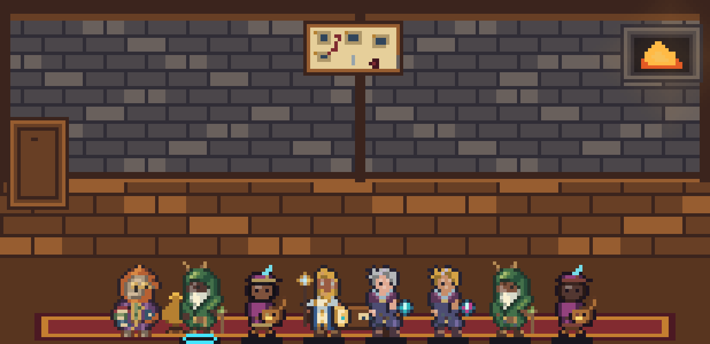
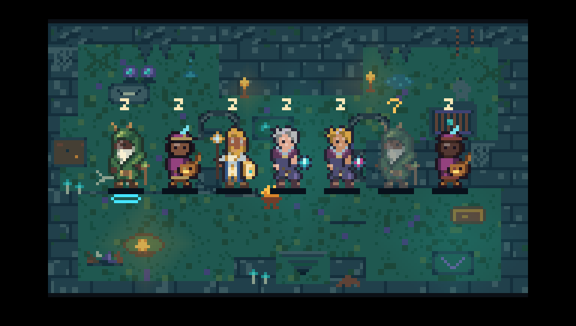

# Hall and Delve composition regression review — 2026-11-17

| Work receipt | Result |
| --- | --- |
| result | complete |
| claim | Both screenshot layouts are reproduced by current production source. Hall fitting depends on station occupancy; Delve crowd placement collapses the party into rows. This is a review, not a repair. |
| evidence | Forty current-source exports, measured fit failures/actor bounds, two generations with identical PNG hashes, 64 focused tests, format and Clippy checks, and a local capacity audit. |
| remaining uncertainty | Screenshot cell geometry is unmeasured. Proposed replacement spill positions and their native visual behavior are not implemented or accepted. |
| next | Needs follow-up: preview station-preserving overflow in Storybook, then correct production after the composition is reviewed. |

Scope: the application layout and fit paths in Rust 2024 / MSRV 1.90, plus local
artifact capacity. The user asked for review before continuing. Production
source, tests, launchers, runtime, Herdr resources and configuration were not
changed by this review. Existing dirty work is preserved. The release binary
still has SHA256 `f9e2f32004e9dcda299ba549a3fc334fc21512ff4cca29080f8a4f3bd85ae5b9`.

## Must fix: Hall state changes can abandon proportional fitting

The Hall has one hearth slot and three shared overflow alcoves
(`src/scene/render/guild_hall.rs:70`, `:1092`). Six resting adventurers and one
unknown allocate only five canonical positions. `FitScene::project` rejects
that partial placement at `src/scene/fit.rs:169`, before the native output path.
The existing complete compact fallback then puts full masters at the bottom
of a viewport-sized room (`guild_hall.rs:214`, `:660`). This exactly reproduces
the screenshot's large wall and bottom party, even in a large pane.

The seven-person mixed fixture fits; the seven-person resting/unknown fixture
does not. All four reviewed terminal sizes show this difference. Responsiveness
therefore changes with presence distribution even though the room, party count,
terminal capability and available geometry are the same.

**Rule:** the approved whole-room proportional-fit direction; the Rust testing
guidance to verify observable behavior, not merely counts. Existing partial-party
rejection is correct and must stay. The allocation policy needs correction.

**Recommended fix:** keep a complete canonical room for ordinary parties, retain
valid primary station placements, and allocate only overflow to collision-checked
authored spill positions across the room. Preserve literal state cues and poses
when a spill position lies outside the primary station. Do not simply remove the
capacity check, fit the current compact bottom row, or silently omit actors.



This is a current-source render, not a screenshot. Names/header/footer text are
omitted. Source geometry and complete actor bounds are in `measurements.json`.

## Must fix: Delve saturation relocates the entire party into a row

At `src/scene/render/delve.rs:313`, any saturated station switches the whole
ordinary party to `ActorLayout::Gathered`. `gathered_anchors` (`:989`) has eight
columns, so a seven-person party gets one horizontal row. An eleven-person party
gets two rows. Native fitting still succeeds: this screenshot exposes a layout
regression inside the fitted image, not loss of native transport.

The reviewed seven-person mixed fixture also gathers, because working actors
share the active station's two-slot limit across campaigns. The previous crowd
repair deliberately introduced this all-party fallback. It retained sprites and
the dungeon, but erased the station composition as soon as any station saturated.

**Rule:** the approved scene-first spatial composition and the same observable
behavior testing guidance. Current bounds/count checks establish visibility;
they do not establish preservation of the room's composition.

**Recommended fix:** preserve actors that already fit their stations and add
overflow around authored room positions. Keep unknown/resting/working cues
truthful, furnishings legible, complete actor silhouettes and transformed click
targets. Do not replace the row with another generic all-party grid.



## Measurements and the missing acceptance contract

At 120x34, using a fixed 8x16 physical-pixel cell:

| Fixture | Hall fit | Delve fit | Result |
| --- | --- | --- | --- |
| Five: four resting, one unknown | Yes | Yes | Hall still distributes; Delve gathers into one row. |
| Seven: six resting, one unknown | No, 5/7 positions | Yes | Hall compact fallback; Delve one row. |
| Seven mixed | Yes | Yes | Hall distributes; Delve one row. |
| Eleven: ten resting, one unknown | No, 5/11 positions | Yes | Hall compact fallback; Delve two rows. |
| Eleven mixed | Yes | Yes | Hall distributes; Delve two rows. |

The same fit choices occur at 206x50, 96x28 and 80x24. The export simulates the
production native-or-half-block branch using confirmed fixture geometry; it
does not negotiate or display a terminal image. The actors use current assets.

The focused suite passes **64 tests**: 18 Delve, 30 Hall and 16 world-fit tests.
This does not contradict the screenshots. In particular,
`tests/world_fit.rs:89` explicitly expects crowded Hall fitting to be disabled,
and `tests/scene_delve.rs:812` checks retained background and complete masters
without asserting spatial distribution. Passing the previous full gate did not
qualify this composition. The previous profile repair remains a separate change.

Before a repair, add failing tests for fit across presence distributions at
party sizes 5, 7 and 11, retaining the authored room and all complete click
targets. Cover the transition into station saturation without relocating the
whole unaffected party. Review all-resting, unknown, working, blocked and mixed
parties; preserve existing profile masking, unsupported-graphics fallback,
semantic animation deadlines and dense-party limits. Run the complete gate only
after the replacement composition is implemented.

This review's proposal is bounded to layout in the existing RGB painters and
Storybook fixtures. It adds no renderer, native transport, domain truth, manual
sprite control, persistence or Herdr command. Herdr station facts remain owned
by Herdr; spill positions are presentation with explicit state cues.

## Artifact capacity

The local APFS data volume reports **13 GiB available**, **97% capacity**. That is
enough for these bounded exports and cached verification; it is not an assessment
of any external artifact quota. Current build output is **6.2 GiB**, including
**5.6 GiB debug** and **508 MiB release**. Before these new exports, repository
review artifacts were about **75 MiB** (45 MiB `docs/reviews`, 30 MiB design
reviews). This review adds about **1.4 MiB**. The five current native-fit probe
directories total about **128 MiB**; retained dogfood state is **1.4 MiB**.

No cleanup is needed for this slice and none was performed. Preserve trial
state, transcripts, pinned binaries and historical review evidence. The first
test invocation encountered missing locked Cargo archives and sandbox DNS;
restoring those exact archives allowed all 64 tests to pass. This was not a
space exhaustion failure, and no manifest or lockfile change was made.
See `capacity.json` for the captured local readings.

## Reproduction and evidence

```sh
bash docs/design/reviews/2026-11-17-party-layout-regression/regenerate.sh
cargo test --locked --all-features --test world_fit --test scene_guild_hall --test scene_delve
cargo fmt --check
cargo clippy --all-targets --all-features -- -D warnings
```

The exporter compiles against current production library APIs with warnings
denied. `measurements.json` records fit failures, allocated counts and exact
source actor bounds. Native source frames use 160x90; fallback source frames
use terminal columns by twice terminal rows. The PNGs simulate physical 8x16
cells with exact nearest-neighbor pixels; blank native header/footer lanes
reserve the production footprint without painting overlay text.

Both generations produced identical hashes. Source hash comparison, commands,
focused logs and binary identities are recorded in `verification.json` and its
supporting files. No full gate, release build or native visual acceptance was
claimed for this review. No Computer Use or alternate GUI automation was used.
The retained dogfood party was not operated or cleaned up.

What to keep: the single RGB renderer, lossless fit transform, partial-party
rejection, shared mouse geometry, profile mask, source-owned states, complete
silhouettes and bounded semantic animation. The correction belongs in placement,
with stronger composition acceptance rather than more transport changes.
