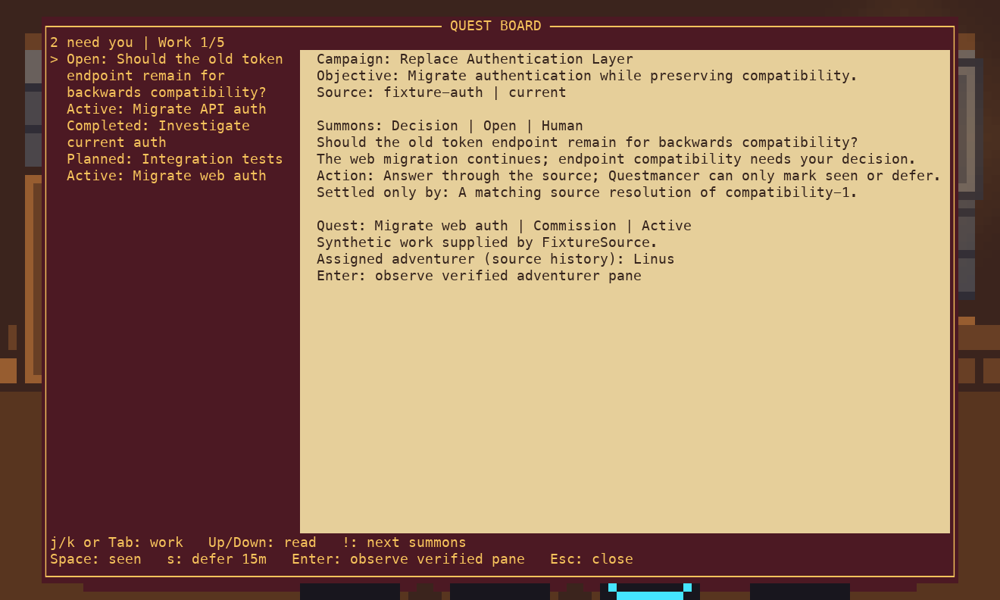

# M1 durable obligations — 2026-09-30

M1 is complete for its approved fixture-backed scope. Engineering qualification
passed and the user approved the corrected production Quest Board visuals on
2026-09-30, after the truncation repair. The approved browser concept is separate from the Rust
production exports below. This is an unreleased dirty-checkout receipt, not a
clean-commit, live-source, native-terminal or publication receipt.

## Scope and baseline

Branch `main`, base HEAD `f380720` (`Clear pane headers on shutdown`), ahead of
`origin/main` by six commits. No commit, release, plugin installation or shared
Herdr server operation was performed for this slice.

Existing dirty work was preserved: AGENTS/PLAN/README and operational docs,
command/protocol/client/pane-header/runtime source and related tests; real-agent
Chronicle and pane-header review/plan files were already untracked. The full gate
qualifies the combined current checkout, not an isolated M1 diff. Existing
pane-header native/platform acceptance is not established by this receipt.
[Final file status](git-status.txt) records the exact tracked/untracked paths.

The approved [M1 plan](../../plans/2026-09-27-durable-obligations.md) extends the
live domain with source-qualified work, human obligations, artifacts, local intent
and a separate cache. Herdr remains authoritative for live agents. Source-owned
resolution is distinct from local seen/deferred intent. No source answer, work
assignment, agent spawning or orchestration is added.

## Delivered behaviour

- `src/work/` provides a pure baseline/update reducer, revision/incarnation
  fences, complete/partial coverage, retirement high-water marks and deterministic
  attention ordering. Gaps/conflicts retain prior facts and require reconciliation.
- An independent bounded source inbox supplies runtime messages. FixtureSource is
  inert test/Storybook data; ordinary startup has no synthetic work source.
- The persistence worker acknowledges atomic `work-state.json` publication before
  work facts or local intent become durable UI state. Failure preserves the prior
  checkpoint. Restart restores cached/unverified facts without live session bindings.
- `!` reaches source-owned human obligations, then legacy summons. Supervisor and
  external waits do not create human alerts. Explicit matching episode correlation
  is required to collapse a source/legacy duplicate.
- `b` opens the contextual Quest Board in the existing scene/overlay path.
  `j/k` or Tab/Shift-Tab selects work; Up/Down or wheel scrolls details;
  Space marks seen; `s` defers 15 minutes; Enter observes only a verified live
  binding; Esc closes. Seen leaves the obligation open. Deferral has one semantic
  expiry wake. There are no upstream reads on animation frames.
- Details retain source/freshness, literal request and resolution criterion,
  campaign objective, lifecycle, assignment history, dependencies and artifacts.
  Revision-mismatched artifact validation is Unknown. Wide inventory titles wrap
  with indented continuation lines; selection scrolling accounts for wrapped rows.

## Engineering evidence

| Command | Result | Retained evidence |
| --- | --- | --- |
| `just verify` | Passed: 696 Rust tests across 59 runs; 28 shell tests; formatting, Clippy warnings denied, all targets/features and script syntax | [Full gate](verify.log) |
| `just property-test 4096` | Passed: 82 tests across four runs, property generators configured for 4,096 cases | [Property gate](property.log) |
| `cargo test --all-features --test work` | Passed: 29 tests | [Work suite](work.log) |
| `cargo build --release` | Passed; production source unchanged after this build | [Release build](release-build.log) |
| `git diff --check` | Passed | [Machine receipt](verification.json) |
| Production cell export test | Passed; nine actual Ratatui production buffers | [Export](export.log) |
| 1/10/100 inventory measurement | Passed; bounded queue and overlay paths exercised | [Load measurement](load-measurements.log) |

The 4,096-case property log is retained from the preceding M1 qualification;
the generated domain properties were unchanged by the truncation repair.

The composed all-feature test uses the actual FixtureSource/inbox, runtime work
acceptance, Herdr exit reducer, persistence worker and Board deferral action.
It preserves the decision through unrelated progress and bound-worker exit,
flushes and stops the worker, restarts from cache, reconciles a matching baseline
and applies exact source resolution. Work remains Active; no XP is awarded.
The default-feature version exercises unbound work. Other tests cover stale
closes, new incarnations, partial/complete coverage, old generations, gaps,
conflicting duplicates, source isolation, managed/reused pane exclusion,
acknowledgement/publication failure, future/malformed snapshots and dependencies.

The work-only composition creates no legacy state or Chronicle file. The existing
mixed v1/v2 Chronicle and atomic-state suites pass in the full gate; the legacy
schemas and history replay semantics are preserved.

Two earlier full-gate failures were repaired: verbose new key descriptions made
the fixed Ledger keyring overflow ([first run](verify-first.log)); the shell
contract still asserted 45 Storybook stories after the seven Board variants
brought the catalogue to 52 ([second run](verify-second.log)). The final full gate
passes both checks. Focused new behaviour was developed test-first; supplementary
qualification tests then tightened edge cases and composed restart coverage.

Debug measurements average queue derivation plus overlay rendering over the
synthetic workload: 1,039 / 1,148 / 1,779 microseconds for 1 / 10 / 100 agents and
obligations. The fixed viewport yielded 1 / 5 / 1 visible actor hit regions.
These are observations from the tested scene/fallback composition, not renderer
capacity limits, release-mode benchmarks or five-second human comprehension proof.

## Truncation correction after user review

The user identified cut-off inventory titles in the production preview on
2026-09-30. The fixed 30-cell list rendered each label on one unwrapped line;
Ratatui discarded text beyond the column. The corrected list shares the detail
word-wrapping helper, reserves two cells for selection/continuation indentation,
and scrolls according to wrapped rows so selected titles stay visible in short
wide panes. The source request and navigation semantics are unchanged.

The focused regression first reproduced the missing full compatibility question
([red](truncation-red.log)), then passed with full fixture titles and selection
visibility at 120x38 and 80x12 ([green](truncation-green.log)). All nine production
exports were regenerated and the populated render was visually inspected. The
full gate and release build in this receipt cover the repair. The user then
responded “Approved” on 2026-09-30 to the corrected production preview, satisfying
the M1 production visual gate. This does not establish native terminal acceptance.

## Production visual review

These images rasterise actual Ratatui TestBackend cells from production RGB and
parchment paths. `render_cells.py` uses the host Menlo font and paints half-block
RGB cells explicitly. They were inspected locally. They are not Ghostty captures,
native portrait evidence or live adapter acceptance.



| State | Review purpose |
| --- | --- |
| [Narrow](images/narrow.png) | 48-column detail wrapping; scroll to remaining fields; every item remains keyboard-reachable |
| [Worker exited](images/worker-exited.png) | Historical assignment and open decision retained; observation unavailable |
| [Deferred](images/deferred.png) | Source decision stays Open; local 15-minute deferral skips queue eligibility |
| [Resolved](images/resolved.png) | Matching source close settles the decision; quest remains Active |
| [Offline](images/offline.png) | Attributed last-known facts survive disconnection |
| [Cached restart](images/cached.png) | Unverified cache; no restored live binding or observation action |
| [Artifact](images/artifact.png) | Illustrative PR #481 with `example.invalid` URI; head and validation Unknown |
| [Empty](images/empty.png) | Empty work projection remains reachable over the existing Hall |

The `need you` count includes legacy summons. For example, the empty work story
still contains one legacy summons; resolution/defer removes only the eligible
source obligation. The seven fixed Board stories make the Storybook total 52:
two worlds, 37 asset views and 13 interactions. Cached and artifact exports are
additional review selections, not extra catalogue entries.

To reproduce the exports:

```bash
QUESTMANCER_BOARD_EXPORT=docs/reviews/2026-09-30-durable-obligations/images \
  cargo test --all-features --test work production_board_review_exports_when_requested
python3 docs/reviews/2026-09-30-durable-obligations/render_cells.py
```

The rasteriser requires Pillow and the macOS Menlo font. `just storybook` supplies
terminal-free source data in the normal production rendering path; fixed-story
navigation differs from Board controls. Use the
[manual recipe](../../manual-test/questmancer-scene-preview.md#quest-board-fixture-review-m1-unreleased)
for terminal review.

## Compromises and remaining gates

1. Persistence is an acknowledged full snapshot, serialised by the existing
   worker. There is no work journal, crash replay, historical time travel or
   authoritative Chronicle reconstruction. Complete coverage can discard entity
   payloads while retaining revision tombstones; it is not archival history.
2. The internal protocol retains only the latest accepted event payload for
   duplicate/conflict checks. Cursor gaps mark reconciliation; M1 has no external
   adapter that requests and supplies the recovery baseline.
3. One optional source inbox is attached to runtime. Multiple homes/source
   multiplexing and adapter capability negotiation remain future work.
4. Typed events require timestamps. A future adapter must assign and retain a
   first-observed fallback for missing upstream times rather than regenerating it.
5. Persistence tests inject failure before atomic replacement and verify protected
   prior bytes, worker acknowledgement, suppression and orderly restart. Abrupt
   process death and power-loss boundaries were not simulated.
6. The user approved the corrected production Quest Board visuals on 2026-09-30.
   The required M1 production visual gate is satisfied. Native terminal
   input/resize/portrait acceptance and live work-source acceptance remain
   separate, unperformed checks.

With M1 accepted, the recommended next bounded phase is M2
War Table: dependencies and affected work through the same RGB renderer. A live
Herdr Projects adapter may instead be promoted explicitly if live usefulness is
more valuable next. Neither phase is started by this receipt.
