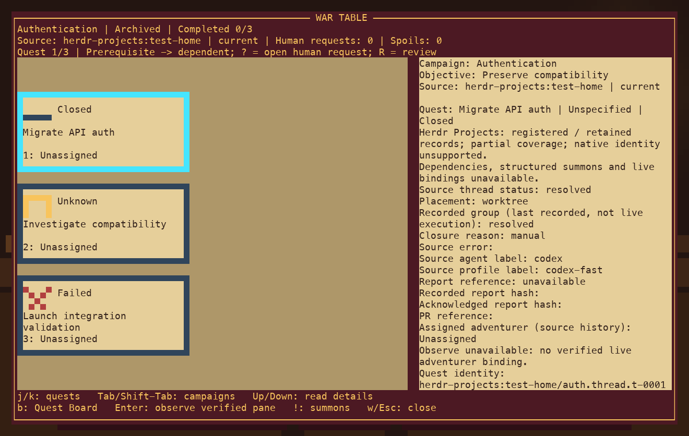

# M3a.2 registered mapper and atomic cache — 2026-09-30

**The approved synthetic mapper/cache proof is implemented and engineering-qualified,
unreleased.** Production visual approval, native interaction, runtime attachment
and live-source acceptance remain separate. The user approved this code slice
after the [identity/coverage decision](../../design/herdr-projects-identity-coverage.md).
No shared server, installed plugin, real project home or real agent was operated.

## Result and boundaries

`src/sources/herdr_projects/mapping.rs` maps a validated locked DTO under explicit
registration. Source-qualified retained thread IDs are stable across reopen and
label changes; canonical creation evidence lives in a typed checkpoint. Changed
evidence or missing registration is a hard identity error; omission of a known
thread rejects the batch. Unlocked exports remain inspection-only. No complete
coverage, invented obligations/dependencies, live binding or successful delivery
is emitted. Native identity remains Unsupported, including the documented
indistinguishability of identical copies/restores.

Generic Unspecified/Unknown/Closed/Archived values represent the source faithfully.
Closed uses a neutral bar; Unknown uses a hollow marker. Neither uses completion
or working theatre. Group/status/placement labels use literal source vocabulary.
Agent/profile labels stay attributed context: no stable worker identity is supplied,
so assignment remains absent. Latest report/PR reference slots update revisions,
revoke unavailable URIs and retain unknown validation; no report body is stored.
Report URIs remain absent; PR URIs follow the strict GitHub syntax allowlist.

`work-state.json` now uses a v2 atomic envelope for projection plus bounded typed
observer checkpoints. Valid v1 loads losslessly as Cached and migrates only on
publication. Duplicate keys at every depth, invalid checkpoint/projection pairs,
future versions and malformed files are protected. Reads/writes are limited to
16 MiB and checkpoint collection size to 128; each project retains at most 1,000
threads. Ordinary intent/fixture writes preserve registered checkpoints and cannot
overwrite their source facts. Publication validates the accepted base before
replacement; the worker acknowledges before facts/checkpoint become visible.
All restarts clear bindings and restore unverified facts. State/Chronicle/XP formats
and semantics are unchanged.

The reducer stays source-neutral. Persistence explicitly knows typed adapter
checkpoints, rather than accepting arbitrary adapter JSON. The consumer returns
typed identity failures requiring rebind; **the later producer must latch them**,
own the directory lease and discard old read completions. Those producer guarantees
are not implemented or qualified by this slice. No source configuration, polling,
transport attachment, URI opening, source write or execution command was added.
The existing atomic-file primitive is reused; no new work journal is introduced.

## Verification

Baseline: dirty `main` at `f380720ba63424b279980ff4f1c164d8fd4ef735`, ahead six.
The pre-existing M1/M2, M3a.1 and pane-header changes were preserved; see
[baseline hashes](baseline.json) and [status](baseline-status.txt).
Pinned upstream source remains Herdr Projects 0.2.34 at
`4e4548c3c43888e6be1c96906215998f07dc63f0`; no upstream code was changed or run.

- Final `just verify`: **739 Rust tests across 61 runs, 28 shell tests**, formatting,
  all targets/features, Clippy with warnings denied and script syntax passed.
- `just property-test 4096`: **123 tests across six runs**, including source
  isolation/inert repeats, omission safety and duplicate-key properties, passed.
- Source suite: **31 tests** with all features passed. Focused tests also cover
  domain/War Table, persistence worker and composed runtime behaviour.
- Release build and final document/diff checks are recorded in
  [verification manifest](verification.json).

Tests prove locked baseline -> change -> rejected omission -> retained recovery ->
failed publication -> retry -> atomic restart, reference loss, canonical creation,
v1 intent preservation, file protection, counter exhaustion and stale proposals.
The first failing tests are retained in the `*-red.log` receipts. Later focused
regressions exposed missing report-slot revision updates, stale-generation error
classification, debug-label leakage and duplicate-proposal freshness downgrade;
all are covered by the final gate. Earlier full passes preceded those final fixes
and are labelled accordingly. A sandboxed runtime test could not bind its owned
Unix socket; affected/final verification ran with that restriction lifted.

This is synthetic engineering evidence, not native/live acceptance, clean-source
packaging, publication, or proof of five-second comprehension. No commit, release,
installation, server restart or rollout was performed.

## Production presentation review — awaiting user approval

These images rasterise actual production Ratatui cells using the existing RGB
scene/overlay path and macOS Menlo. They are fixture output, not native terminal
captures. Local inspection checked literal context, neutral cues, zero invented
human requests and narrow wrapping/scroll affordances. Human approval is pending.

| Image | Intended fact |
| --- | --- |
| [Selected Unknown](images/unknown-table.png) | Recorded working group does not become active execution |
| [Quest Board](images/board.png) | Literal source context with unsupported capabilities visible |
| [Narrow Board](images/narrow-board.png) | Selected details wrap; remaining content stays scrollable |

Regenerate with `QUESTMANCER_PROJECTS_EXPORT=docs/reviews/2026-09-30-herdr-projects-mapper/images cargo test --test herdr_projects_source registered_mapping_production_surfaces_export_when_requested --all-features`,
then run `render_cells.py` with the bundled Python runtime providing Pillow.

After visual approval, the next proposed slice is M3a.3: disabled-by-default
selection, owned producer/acknowledgement, leases and cancellation, tested against
disposable source trees. Real homes/agents, installed-source qualification and
isolated Herdr live testing require their separate operational scope. M3b and
M4–M7 remain unpromoted.
