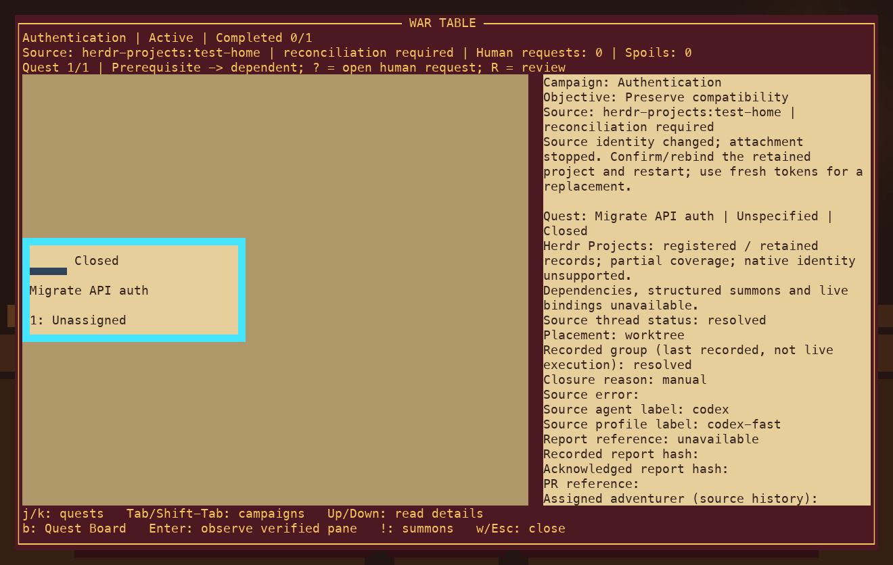

# M3a.3 opt-in Herdr Projects runtime — 2026-09-30

**Implemented and engineering-qualified, unreleased. Changed
diagnostic visuals await user approval.** The user approved the M3a.2 review and
promoted this bounded runtime slice. Only disposable source trees were exercised.
No real home, installed plugin, shared server or real agent was operated.

## Result and architecture

The optional `[herdr_projects]` configuration is disabled by default. Enabled
selection requires explicit source/campaign tokens, an absolute physical project
locator, pinned layout and retained-record policy. Startup restores the existing
atomic projection/checkpoint; protected caches or absent durable storage disable
attachment. Token/checkpoint collision cannot adopt unrelated cached work.

RuntimeLifecycle owns an independent producer and SourceInbox for both Herdr
and offline modes. There is one read and one acknowledged delivery outstanding.
The consumer rechecks the ephemeral descriptor lease, maps against current work,
publishes the atomic pair, then acknowledges its checkpoint. The lease survives
failed first reads; observed root loss/replacement and creation/registration
identity changes stop attachment until owner reconciliation. Old generations are
fenced before any fact or health mutation, including failed lease completions.
Transient read, lock, omitted-record and publication failures retain prior facts
and retry. Recovery advances observer generation without inventing outcomes.

Healthy reads are five seconds apart; failures back off from five to thirty
seconds. Capture has a two-second cooperative budget and cancellation checks
between bounded regular-file reads. Shutdown cancels and joins the owned producer
and capture before the existing persistence flush. The existing source/cache
bounds are unchanged. No source writes, shell/agent/execution commands, report
acknowledgements, live bindings, structured summons, Chronicle or XP are added.

Unchanged probes do not publish or redraw. The UI preserves its current frame
and animation deadline while waiting for a meaningful change. One ephemeral
source diagnostic is projected into existing Board/Table details; it remains
visible when older cached work from another campaign is selected. Source faults
are independent from Herdr supervisor resubscription. No room, actor or renderer
was replaced. Source coverage remains Partial and native identity Unsupported.

See the [implementation plan](../../plans/2026-09-30-herdr-projects-runtime.md)
and [configuration/operating guide](../../manual-test/herdr-projects-inventory.md).

## Qualification evidence

Baseline: dirty `main`, ahead six, at
`f380720ba63424b279980ff4f1c164d8fd4ef735`. Pre-existing M1/M2, pane-header and
M3a.1/M3a.2 work was preserved; [baseline hashes](baseline.json) and
[initial status](baseline-status.txt) record it. The
[verification manifest](verification.json) records final checks, hashes, exact
counts, changed-file scope and [final status](git-status.txt).

- Full `just verify`: **754 Rust tests across 62 runs, 28 shell tests**, formatting,
  Clippy with warnings denied, all targets/features,
  Rust tests, shell behaviour and script syntax; see [log](verify.log).
- `just property-test 4096`: 123 tests across six runs; [log](property.log).
- Producer suite: 12 tests with all features; [log](source-final.log).
- Release build: [log](release-build.log). Nothing was installed or opened live.
- Final scope/hash, local document links and `git diff --check` are in the manifest.

Composed tests cover baseline -> unchanged -> edit -> lock/parse/omission/storage
failure -> retained recovery -> atomic cache restart, creation latching, root
replacement after a failed first read, queued and obsolete lease completions,
shutdown with unacknowledged delivery, protected startup, offline lifecycle,
source-byte invariance and diagnostics over another selected cached source.
Cancellation/expired-budget checks reject reads before filesystem access.
Focused failing assertions and missing-interface failures are retained in
`*-red.log`. The first producer fixture used an incorrect source enum spelling;
its diagnostic is retained separately and the fixture corrected. Earlier full
passes/Clippy failures are labelled; the manifest selects the final gate only.
Full verification needed its disposable test-owned Unix sockets outside the
filesystem sandbox; no shared Herdr server was involved.

[Single synthetic captures](capture-cost.json) at 1/10/100 threads took about
4.9/3.4/6.2 ms on this host, with 956/3,405/27,976-byte DTOs. These are warm
fixture measurements without report bodies, not a throughput benchmark or a
claim about real homes. The retained bounds and cooperative budget govern reads.

## Architectural limits and remaining gates

The same consumer/persistence boundary explicitly understands typed adapter
checkpoints; the core work reducer and UI remain source-neutral. Configuration
reload/rebind is an owner operation followed by restarting Questmancer. Tokens
and retained creation evidence remain a continuity assumption across restart;
identical unobserved copies/restores are not detectable native identities.

An OS filesystem call cannot be forcibly interrupted. Cancellation and the
two-second budget are cooperative; joining can take longer on a stalled filesystem.
Remote/network-mounted filesystem behaviour and installed Herdr Projects/Herdr
0.9.1 compatibility were not qualified. No shared-server upgrade occurred.

This is synthetic engineering evidence. Native terminal input, installed-source
compatibility, live Herdr, clean-source packaging, five-second usefulness and
publication remain unperformed. Changed diagnostics need product visual approval.
M3b request/binding contracts and M4–M7 remain unpromoted. No commit, release,
installation or rollout was performed.

## Production diagnostic review — awaiting approval

Actual production RGB/overlay Ratatui cells were rasterised with macOS Menlo.
They are fixture output, not native terminal captures. Local inspection checked
wrapping, literal state, retained facts and the absence of invented human requests.

| Image | Behaviour |
| --- | --- |
| [First-read failure](images/first-read-failure.png) | No inventory yet; the selected source's diagnostic remains readable |
| [Retained unavailable](images/retained-unavailable.png) | Narrow Board keeps last-known work and scrollable context |
| [Identity reconciliation](images/identity-reconcile.png) | War Table retains neutral Closed work and explains the stopped attachment |
| [Other campaign error](images/other-campaign-error.png) | A newly selected source fault remains visible over older cached work |

Regenerate with `QUESTMANCER_PROJECTS_RUNTIME_EXPORT=docs/reviews/2026-09-30-herdr-projects-runtime/images cargo test --test herdr_projects_runtime --all-features`,
then run `render_cells.py` with the bundled Python/Pillow runtime. Keep the
[M3a.2 visual approval](../2026-09-30-herdr-projects-mapper/visual-approval.md)
separate from this changed diagnostic review and any later live trial.
