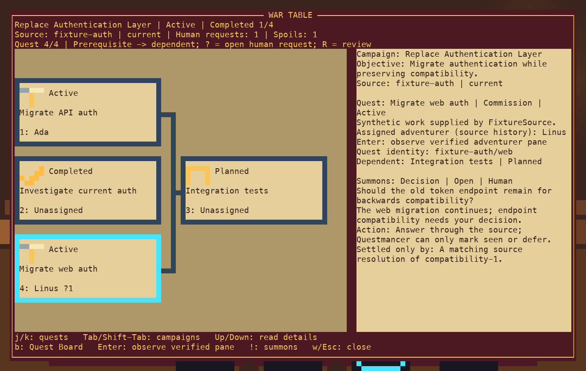

# M2 War Table — 2026-09-30

The user promoted M2 after accepting M1. The bounded fixture-backed War Table is
implemented inline, engineering-qualified and production-visually approved by
the user on 2026-09-30. M2 is complete within its fixture-backed scope and unreleased.
This is a dirty-checkout receipt, not a commit,
release, native-terminal or live-adapter acceptance record.

## Scope and baseline

Branch `main`, HEAD `f380720` (`Clear pane headers on shutdown`), ahead of
`origin/main` by six commits. The accepted M1 and unrelated pane-header repair
were already uncommitted. Their source, tests and documentation were preserved.
The full gate qualifies the combined checkout; it is not isolated M2 evidence.
[File status](git-status.txt) records the final tracked/untracked paths.
No shared Herdr server, plugin registration, agent process or real pane was
operated for M2. Verification uses only resources owned by its automated tests.

The [M2 plan](../../plans/2026-09-30-war-table.md) bounds the work to dependency
context and selected evidence. Sources retain work lifecycle, requests, assignment
and resolution. The Table neither plans nor executes work. The live-only
SceneSnapshot and existing Hall/Delve worlds are unchanged in responsibility.

## Delivered behaviour

- `src/work/graph.rs` projects one source-qualified campaign into explicit
  prerequisite-to-dependent edges, deterministic DAG layers, cycle diagnostics,
  ownership history, human/review requests and artifact counts. Missing and
  outside-campaign prerequisites remain attributed; no readiness is inferred.
- `ScenePresentation` carries the separate work graph. The RGB table is laid out
  by `src/scene/war_table.rs` and painted through the existing world rendering path
  by `src/scene/render/war_table.rs`. `src/ui/war_table.rs` adds contextual text.
  Existing authored tool/check cues and parchment colours are reused.
- `w` opens/closes the Table, including from the Board. `j/k` cycles quests;
  Tab/Shift-Tab cycles work campaigns; Up/Down or wheel reads complete details;
  `b` opens the selected quest in the Board; Enter uses the existing verified
  binding guard; `!` retains M1 attention ordering. No agent editing key leaks
  through the Table. Navigation and campaign selection are ephemeral.
- Source lifecycle stays literal. `?` counts source-open human requests and `R`
  counts human review requests. Local deferral can suppress queue eligibility
  without removing the source request cue; this is not a second alert policy.
- A fitting DAG renders every campaign node and internal edge. Cyclic or oversized
  campaigns use a labelled, selection-following inventory; dependencies and
  dependents remain readable in details, including outside-campaign references.
  Narrow views show details and explicit map-unavailable copy. Below 28 columns
  or 12 rows the overlay is status-only.
- Full titles, literal requests, responsibility/resolution, historical ownership
  and artifact validation remain readable in details. Compact card/header labels
  use an explicit `...` marker. Campaign requests/artifacts without a quest binding
  also appear in details. Old-head artifact validation remains Unknown through the
  shared M1 evidence formatter.
- The Table is static and returns no animation deadline or covered live actor hit
  regions. Rendering does not mutate work, persist state, load output or query a
  source. Work caches, source ingestion, legacy Chronicle and XP rules are unchanged.

## Engineering evidence

| Command | Outcome | Evidence |
| --- | --- | --- |
| `just verify` | Passed: 707 Rust tests across 60 runs, 28 shell tests; formatting, Clippy and script syntax | [Full gate](verify.log) |
| `just property-test 4096` | Passed: 92 tests across five runs; generators configured for 4,096 cases | [Properties](property.log) |
| `cargo test --all-features --test war_table` | Passed: 11 tests | [Table suite and exports](work-table.log) |
| Table plus Storybook suites | Passed | [Focused integration](table-storybook.log) |
| `cargo build --release` | Passed for the final source | [Build](release-build.log) |
| `git diff --check` | Passed | [Machine receipt](verification.json) |

The property gate includes the new generated-DAG property: all explicit
prerequisites appear before their dependents in layout layers, while source
quests remain Planned. It ran before the final extraction of a text-rendering
helper; graph/property code was unchanged by that refactor or the later display-label correction. The complete gate
covers the final rendering code and all existing M1/domain/persistence tests.

Tests exercise exact edges, source-qualified campaign navigation, empty campaigns,
selection removal, missing/outside dependencies and cycles, local deferral versus
source state, contextual input, small-size detail scrolling, complete visible
card bounds, 100-quest selection across pages, deterministic RGB output and no
animation wake in full/reduced/no-motion modes. These prove engineering contracts,
not human comprehension or native terminal behaviour.

Initial test-first evidence exposed the missing graph boundary ([red](red.log)).
The first production export then revealed dark stripes: Paragraph styling
recoloured retained RGB half-block symbols in text regions. A focused test proved
that failure ([parchment red](parchment-red.log)); text rectangles now clear their
cells before writing. The final suite proves the repair. An earlier full gate
stopped at Clippy's function-size limit ([first gate](verify-first.log)); the
renderer was split into small heading/card helpers. A subsequent gate passed all
707 Rust tests but its shell vocabulary check matched `Site:` inside
`prerequisite:` ([second gate](verify-second.log)). The label was reworded to
“Prerequisite outside campaign”; the guard remains intact. No warning suppression
was added.

## Production visual review

These are actual production RGB and Ratatui cell exports, rasterised with the
macOS Menlo font by `render_cells.py`. They were inspected locally. They are not
Ghostty captures, native portrait checks or live work-source evidence.

The user replied “Approved” after the production War Table preview and linked
review pack on 2026-09-30. This records production visual approval only; it does
not establish native terminal interaction, resize or live-source acceptance.



The fixture explicitly supplies API and web prerequisites for integration tests.
Investigation has no declared dependency link; the map does not invent one.
The cyan card is selected; the red border/`?` cue denotes a source-open human
request. Completed counts are source quest facts, not delivery or merge assertions.

| State | Review purpose |
| --- | --- |
| [Narrow](images/narrow.png) | Map omitted honestly; full details remain scrollable |
| [Cycle](images/cyclic.png) | Declared cycle; inventory instead of a false execution order |
| [100 quests](images/large.png) | Visible inventory page follows selection; total remains explicit |
| [Another page](images/large-later-page.png) | A different selected quest/page, no hidden renumbering |
| [Offline](images/offline.png) | Last-known source facts; observation unavailable |
| [Cached](images/cached.png) | Restart facts unverified; no restored live binding |
| [Empty](images/empty.png) | No synthetic success, source or campaign inferred |

Six fixed Table stories bring Storybook to 58: two worlds, 37 asset views and
19 interactions. Two additional exports cover cache and another selected page;
they are not extra catalogue entries. Ordinary startup installs no fixture or
live adapter. Storybook navigation is fixed-story inspection, not production
Table interaction.

Reproduce the review exports with:

```bash
QUESTMANCER_TABLE_EXPORT=docs/reviews/2026-09-30-war-table/images \
  cargo test --all-features --test war_table production_table_review_exports_when_requested
python3 docs/reviews/2026-09-30-war-table/render_cells.py
```

The rasteriser requires Pillow and the macOS Menlo font. Use the
[manual recipe](../../manual-test/questmancer-scene-preview.md#war-table-fixture-review-m2-unreleased)
for terminal review.

## Compromises and remaining gates

1. M2 provides a fitting whole-campaign DAG or an explicit inventory/details
   fallback. It has no pan/zoom, mouse graph selection, graph editing, SCC group
   visualisation or automatic critical-path inference. All work is keyboard reachable.
2. Layout layers describe internal prerequisites only, not execution eligibility.
   Missing/outside dependencies are reported separately. Cycles never imply blocked
   human responsibility or completion; source facts and attention retain their owners.
3. While the Table is open, Hall/Delve animation and covered hit regions are paused.
   Work/Herdr events and the existing semantic attention deadlines still invalidate
   the view. No decorative Table animation is introduced.
4. No live source or new persistence format is added. M1's snapshot/cache and
   reconciliation limitations remain. This does not establish replay/time travel.
5. The user satisfied AGENTS.md's production visual gate on 2026-09-30.
   Native terminal input/resize, live-source usefulness and
   five-second comprehension remain separately unverified. No commit or release.

With M2 product acceptance recorded, the recommended next bounded milestone is M3: a
read-only Herdr Projects adapter with a pinned export/binding/reconciliation
contract. It requires its own promotion and fresh source inspection.
