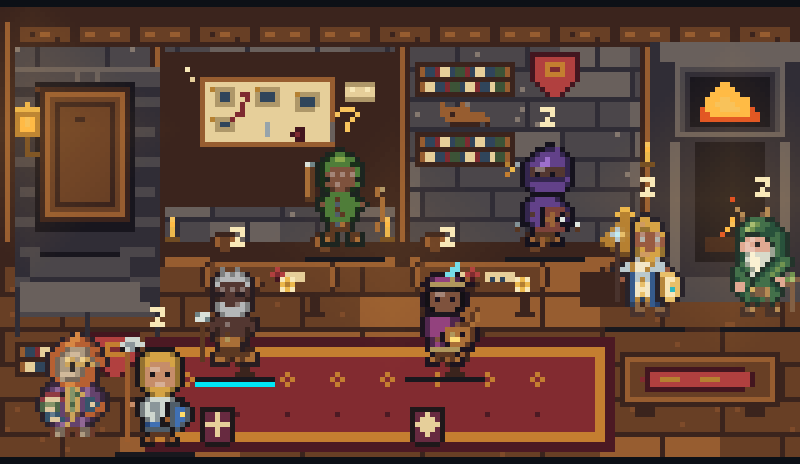
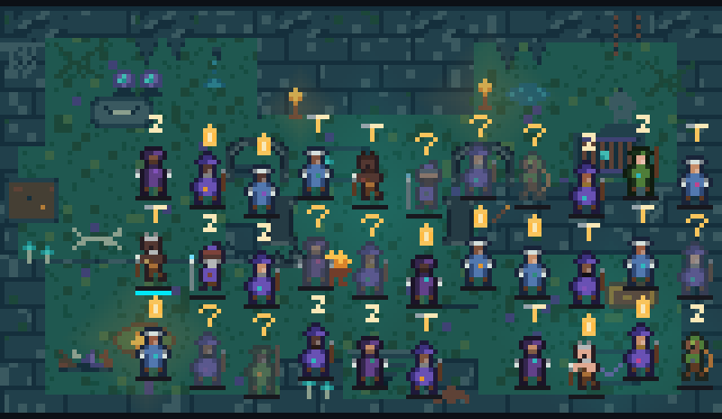

# Automatic fitted-room density — 2026-11-17

| Work receipt | Result |
| --- | --- |
| result | complete |
| claim | Production fitted Hall and Delve choose authored sprite-size tiers automatically and retain steady seats across status changes. |
| evidence | Focused red/green production tests, full verification, release/Storybook/Rustdoc builds, eight executable PTY scenarios, 42 source exports and two byte-exact native payload comparisons. Final hashes/counts and the owned UI refresh are recorded in this directory. |
| remaining uncertainty | Native Ghostty readability, mouse, resize and animation acceptance remain human review. Above 64 visible adventurers retains the existing bounded fallback. |
| next | Needs review: inspect both refreshed rooms and their profiles; use the fixed automatic-density stories for larger parties. |

The owner approved the proposed automatic tiers after reviewing the capacity
comparison. [ADR-0007](../../adr/0007-automatic-party-density.md) promotes that
direction. The original seven-person resting/unknown Hall failed before the fix
with `canonical composition shows 5/7`; the focused red log preserves that result.

| Visible party | Authored sprite | Fitted composition |
| --- | --- | --- |
| 0–11 | 16x24 | Full-size distributed seats. |
| 12–32 | 8x12 | Approved staggered smaller-sprite seats. |
| 33–64 | 8x12 | Denser seating; keyboard Ledger access remains, Librarian actor omitted. |
| Above 64 | Existing fallback | Partial fitted scenes are rejected explicitly. |

Exited adventurers do not count. Source identity determines seating within a
tier; presence and attention update poses/cues rather than moving the entire
party. The complete room keeps its fit. This deliberately supersedes the Hall's
station-saturation fallback and the Delve's gathered row in native fitted views.
Room furnishings do not assign work. The source-owned station/presence facts,
persona assignments and all command authority remain unchanged.





These are actual source renders, not Ghostty screenshots. The full set covers
7, 11, 12, 24, 32, 33 and 64 in both rooms at 120x34, 96x28 and 80x24. See
`measurements.json` for complete actor counts, sprite dimensions and resident
targets. Full 16x24 masters are never downsampled; the smaller art is authored.

## Implementation and boundaries

`src/scene/render/party.rs` is a fitted composition within the existing RGB
engine. It reuses extracted Hall/Delve environment passes with the real snapshot
and semantic plan, rather than fabricating an empty live snapshot. It retains
full-size ritual frames and their deadlines, static small-sprite state glyphs,
Delve unknown mist, connection lighting, Hall cat/goblin behavior and bounded
fresh-spoils/departure effects. Reduced/still scenes have no cleanup wake.

`FitScene` checks actual composed actor counts and addressable mouse targets
instead of rejecting on the old station-slot preflight. No partial-party
success is allowed. Existing raw half-block responsive/camera behavior remains
for unavailable graphics/geometry, modal parchments and native sizes without
sufficient hit resolution. This change adds no second transport or world engine.

Full-size class profiles, native cards, authored profile fallbacks and the
existing masked world-image lease remain. The fitted footer now puts visible
party and counsel counts before selected detail so those counts survive narrower
widths. The Ledger explains neutral seating and state cues. No Herdr data,
persistence schema, configuration, source adapter, agent command or dependency
changed. No Storybook module is imported by production.

The original size comparisons remain fixed concepts, sharing the promoted seat
geometry. Two new automatic stories bring Storybook to 84. These exercise the
actual production fit path, not the forced comparison scale:

```sh
./target/debug/questmancer-storybook --story world.guild-fit-auto --inspect
./target/debug/questmancer-storybook --story world.delve-fit-auto --inspect
```

## Qualification

The production tests cover all thresholds, exited/rejoined membership, complete
and disjoint bodies including the Librarian reservation, independent cell targets,
all five literal state glyphs, status-independent seating, profile masking/cache
and explicit rejection beyond capacity. Full-motion completion becomes quiet at
three seconds in full/small/dense tiers; reduced/still pixels and deadlines remain
stable after fresh-completion expiry. Existing raw room, fallback, semantic domain
and persistence suites remain in the full gate. Old tests that explicitly expected
crowded native fitting to be disabled now assert the promoted complete fit;
unavailable-graphics tests and the partial-party guard remain.

The final full gate passes **841 Rust tests across 67 runs**, **28 shell tests**,
formatting, Clippy with warnings denied and script syntax. Release, Storybook and
Rustdoc builds pass. The release SHA256 is
`910056041754d2d6e8392dcd7aeceabb91b8b000f0795f2a7af2a00b7f6fed98`.

`verification.json` records final commands, counts and artifact hashes. Eight
isolated executable scenarios cover four 32-person profile/resize cases plus
release native, unsupported graphics, missing geometry and native interrupt.
They retain only owned image IDs and restore terminal state. The pinned 32-person
Hall/Delve uploads match every projected RGBA byte at 800x464. See
`pty-profiles.json`, `pty-release.json` and `transport-pixels.json`.

```sh
just verify
cargo build --release --locked --offline
cargo build --features storybook --bin questmancer-storybook
cargo doc --all-features --no-deps
bash docs/reviews/2026-11-17-automatic-density/regenerate.sh
python3 docs/reviews/2026-11-17-automatic-density/pty_profiles.py
python3 docs/reviews/2026-11-17-automatic-density/pty_release.py
python3 docs/reviews/2026-11-17-automatic-density/verify_transport.py
```

Synthetic PTY evidence does not establish visible native compositing or usability.
Computer Use cannot inspect Ghostty; no alternate GUI automation is used. Follow
[the native review checklist](../../manual-test/automatic-density.md). The local
slice is unreleased on dirty `main` at `9c52761`; prior work is preserved. No commit,
push, publication, shared-server/configuration change or real-agent command is
part of this integration.

## Retained live UI

Fresh Herdr 0.9.5 pane/process checks established ownership of `w8:pY`, terminal
`term_660769b53dfe0f`. Only that UI was reopened, from PID 98140 to 35882, on its
existing Delve view. Its own text reports seven adventurers, the new count footer
and zero half-blocks, establishing the fitted adapter branch rather than visual
acceptance. No profile or real-adventurer selection was forced for this check.

All 13 current persona records and authoritative owned-work bytes are unchanged.
The remaining tracked synthetic receiver is preserved; three already-absent
historical synthetic panes were not recreated. Focus stayed on the same pane,
with no focus command issued. Plugin logs contain no entries. The UI and remaining
resources are left open for review. `live-refresh.json`, reduced owned inventories
and `live-adapter-check.json` retain the audit without unrelated pane inventories.
