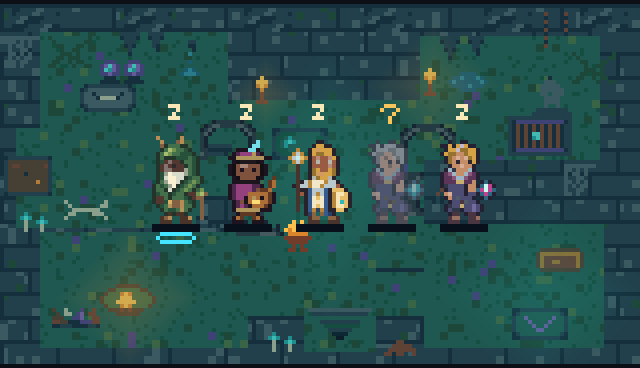

# Crowded dungeon presentation repair — 2026-11-17

| Work receipt | Result |
| --- | --- |
| result | complete |
| claim | The local crowded-party regression is repaired and the verified owned UI is refreshed on the Delve. |
| evidence | 825 Rust tests / 66 runs, 28 shell tests, release/Storybook builds, Rustdoc, five executable PTY scenarios and two byte-exact image comparisons. |
| remaining uncertainty | The corrected native appearance still needs human review in Ghostty. |
| next | Inspect the refreshed dungeon and its resting-crowd Storybook case; recommendation: needs review. |

The owner reported a scene with four resting adventurers, one unknown and a
mostly empty green floor. ADR-0003's station-overflow policy caused this: a third
adventurer at any two-slot station replaced the entire dungeon with a flat roster.
Previous count/click tests passed that policy; they did not establish good native
presentation. This screenshot-driven correction is authorized by “we have an
issue can we solve”. [ADR-0004](../../adr/0004-crowded-delve-room.md) supersedes
that crowd policy.

## Result

Normal station placement and its authored dungeon are unchanged. When stations
cannot contain an ordinary party, a centered gathering of up to sixteen full
16x24 masters appears over the same dungeon. Short rows are independently
centered; furnishings paint first so actors remain complete. Tool, lantern, Z,
check and question cues reuse the authored static markers. Row spacing reserves
room for cues, name lanes and selection runes without covering adjacent actors.

Larger parties or small fallback viewports use authored 8x12 roster sprites over
the dungeon backdrop. The blank floor path is removed. A fixed backdrop center
keeps reduced/still roster rendering stable when completion-related camera
priority expires. Full-motion spoils follow actual gathered actor bounds and
stop after three seconds. Existing Hall behavior, native transport/cache,
geometry, scrying/other parchment paths, source authority and persistence remain.
No masters are downsampled and no live presence is modified to force the layout.

## Render evidence

This is an actual production-source render of the reported presence distribution,
not a screenshot of the refreshed terminal:



The exported set also covers 120x34 and 80x24, eleven concentrated working
adventurers, the ordinary five-person fixture and an empty disconnected room.
`regenerate.sh` builds the current library and runs `export.rs`; it requires no
Herdr, live agent or network. The fixed `world.delve-fit-resting` study reproduces
the regression with local fixture-only controls. Storybook now has 72 stories.

## Test-first qualification

The initial tests reproduced both failures: the reported distribution rejected
native fitting and yielded 8x12 roster bodies rather than full masters. They now
pass at three native review sizes with complete, addressable actor regions and
retained dungeon landmarks. See the red/green logs.

Additional coverage includes concentrated crowds of 3, 5, 11 and 16 full masters,
17/64-person dense composition, bounded unique non-overlapping bodies, retained
room edges, ordinary station placement, full/reduced/still completion deadlines,
and all prior source-pixel, input, card/scrying, cache and room-switch checks.
A focused run exposed a reduced-motion cleanup regression in the newly retained
roster background; fixed room centering repaired it before the final gate.

Final `just verify` passed **825 Rust tests / 66 runs**, **28 shell tests**,
formatting, Clippy with warnings denied and script syntax. Release and Storybook
builds, Rustdoc and `git diff --check` passed. [verification.json](verification.json)
records the candidate and provenance. The release SHA256 is
`3081c199743ab4177d46700ed606de74a6015539c92de2006b831043405c2350`.

## Executable checks

[pty-receipt.json](pty-receipt.json) records five synthetic isolated scenarios:
release native, unsupported graphics, missing geometry, native SIGINT, and the
actual resting-crowd Storybook executable. They cover static suppression, resize,
Ledger paging, both native room switches, transformed gathered-actor clicking,
card/overlay return, exact-ID cleanup and terminal restoration. No live Herdr
resources or Ghostty automation are used by this harness.

Both native release runs uploaded six images and deleted their five world leases.
The resting Storybook scenario uploaded six images and deleted four world leases;
its card/Ledger identities were untouched. World identity count stays bounded
to two. All scenarios restored raw mode, alternate screen and mouse capture.
Unsupported/missing-geometry runs emitted no native images.

The release empty-dungeon payload and the resting-crowd Storybook payload both
match every RGBA byte of their source projections at 800x464 pixels. See
[transport-pixels.json](transport-pixels.json). Transcripts and isolated state
remain under `/private/tmp/questmancer-delve-crowd-repair-20261117/`.

```sh
python3 docs/reviews/2026-11-17-delve-crowd-repair/pty_probe.py
bash docs/reviews/2026-11-17-delve-crowd-repair/regenerate.sh
python3 docs/reviews/2026-11-17-delve-crowd-repair/verify_transport.py
```

## Owned live refresh

Fresh Herdr client/server status was 0.9.5 / protocol22, compatible, with no restart
needed. Terminal identity and foreground process established ownership before
input. Only `w8:pY`, terminal `term_660769b53dfe0f`, was stopped/reopened through
its isolated launcher. Runtime PID changed from `53975` to `68375` with initial
view `delve`. The remaining tracked synthetic receiver `w8:pW` was left unchanged;
three already-absent historical synthetic panes were not recreated. All persona
records and authoritative owned-work bytes were preserved. No focus command was
sent; observed focus changed during refresh and was not overridden.

The post-refresh text receipt has the selected native footer and zero half-blocks,
confirming the fitted adapter branch is active for the current party. It cannot
prove the displayed image. The UI and remaining resources are open for human
review; see [the checklist](../../manual-test/production-delve-fit.md).
[Live receipt](live-refresh.json) and reduced owned inventories record the audit.

This is local, unreleased work on dirty `main` at `9c52761`. Earlier unrelated
changes and the pinned Hall Storybook handoff are preserved. No commit, push,
publication, shared-server/configuration change or real-agent command occurred.
Computer Use cannot access Ghostty, and no alternate UI automation was used.
