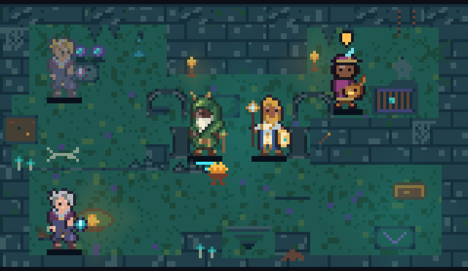
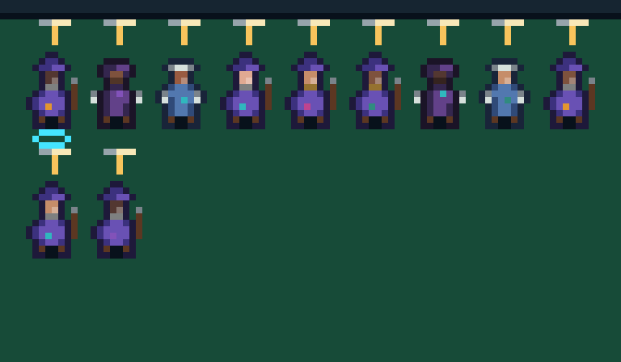

# Proportional Delve integration — 2026-11-17

| Work receipt | Result |
| --- | --- |
| result | complete |
| claim | Local Delve integration is engineering-qualified; the verified existing dogfood UI is refreshed and left open on the dungeon. |
| evidence | 821 Rust tests / 66 runs, 28 shell tests, release build, five isolated executable PTY scenarios, two exact pixel comparisons and owned-resource audit. |
| remaining uncertainty | Native Ghostty visibility, resize, mouse and animation acceptance remain human review. The current crowded live party uses the full roster fallback. |
| next | Review the dungeon with the focused native checklist; recommendation: needs review. |

The user requested the Hall's proportional fit and complete crowded-party
fallback for the “scrying / dungeon view”. This implements that request for the
Delve. The scrying output parchment keeps its existing controls and suspends
native world output while open. No AT Protocol work is included.

[Decision](../../adr/0003-proportional-delve.md) ·
[Manual checklist](../../manual-test/production-delve-fit.md)

## Implementation

- Both existing authored worlds are 160x90. `src/ui/world_fit.rs` / `WorldFit`
  replace the Hall-only adapter, with one shared two-ID image cache, geometry,
  footer and cleanup lifecycle across room switches. This reuses the sole RGB
  scene renderer and existing assets. No new dependency or persistence.
- `src/scene/fit.rs` now checks canonical station capacity for the selected
  world. Hall allocation cannot constrain a dungeon projection. Native output
  requires every non-exited adventurer and its mouse target to fit. The Delve
  has no Librarian actor; the Ledger remains keyboard-accessible.
- `src/scene/render/delve.rs` now uses the existing complete 8x12 roster whenever
  stations are saturated and the party fits that roster, including large panes.
  Previously eleven working adventurers yielded only two actor regions plus
  overflow markers. When the roster cannot fit, the existing crop/overflow
  contract remains. Station capacity and native 16x24 masters are unchanged.
- Existing modal/card, tmux, ANSI16, unsupported geometry/Kitty and tiny-pane
  fallbacks remain. The existing semantic deadlines still own animation and
  no output retrieval occurs during rendering.
- Two fixed studies (`world.delve-fit`, `world.delve-fit-crowded`) use the shared
  projection and local fixture controls. Storybook now has 71 stories. Production
  imports no Storybook code.

## Test-first and full qualification

Before implementation, focused tests failed because native output rejected the
Delve and eleven crowded actors yielded two regions. A third test reproduced
missing Delve Storybook fixtures. The corresponding focused suites now pass.
See the copied red/green logs and [verification.json](verification.json).

`just verify` passed **821 Rust tests across 66 runs**, **28 shell tests**,
formatting, Clippy with warnings denied and shell syntax. Release and Storybook
builds, `cargo doc --no-deps --all-features` and `git diff --check` passed.
The release candidate SHA256 is
`24d0c7bb282938d8ef05269f7bc13eb7b6adeb2f12f980b2f757a123c522321f`.

Production-adapter coverage includes every source pixel and every mouse cell at
120x34, 96x28 and 80x24, complete crowded fallback, all ten canonical slots across
five station kinds, exited exclusion, all eight parchment/card transitions in
both worlds, scrying suspension/resumption, bounded cache identities, shared
Hall→Delve transitions, identical-frame suppression and both worlds' semantic
animation deadlines. Existing Hall, Delve, source and persistence suites passed.

## Executable PTY and pixel evidence

[pty-receipt.json](pty-receipt.json) records five isolated scenarios, with explicit
terminal replies and temporary state/config directories. They use no Herdr or
live agents and do not operate Ghostty:

- release native dungeon: static suppression, resize, Ledger paging, resume,
  Delve→Hall→Delve native switches and clean exit;
- release unsupported graphics: zero native uploads, usable Ledger fallback;
- release missing query/kernel pixel geometry: zero native uploads and fallback;
- release native plus SIGINT: the same transitions with terminal restoration;
- fixed Storybook dungeon: native resize, transformed actor mouse click/card,
  Ledger paging, return to fit and clean exit.

Both native release runs emitted six images (five world uploads plus one Ledger)
and five exact-ID deletions. The Storybook run emitted six images (four world,
one card and one Ledger) with four world deletions. Only two world IDs were used;
card/Ledger identities were never deleted by world cleanup. All scenarios restored
raw mode, alternate screen and mouse capture. Transcripts and isolated state remain
under `/private/tmp/questmancer-production-delve-fit-20261117/`.

Both executable first uploads match their source projections **byte for byte at
800x464 RGBA pixels**: empty disconnected release dungeon and the fixed five-person
Storybook dungeon. [transport-pixels.json](transport-pixels.json) records digests.
This image is decoded executable output, not a native terminal screenshot:



The complete crowded roster source is also exported, without labels/overlays:



Reproduce after building the release and Storybook binaries:

```sh
python3 docs/reviews/2026-11-17-production-delve-fit/pty_probe.py
bash docs/reviews/2026-11-17-production-delve-fit/regenerate.sh
python3 docs/reviews/2026-11-17-production-delve-fit/verify_transport.py
```

The pixel decoder uses Python's standard library. No Python dependency install
or network service is required.

## Bounded live refresh

Fresh Herdr client/server status reports **0.9.5 / protocol 22**, compatible,
with no restart needed. Current inventory revealed that historical synthetic
panes `w8:pS`, `w8:pT` and `w8:pV` were already absent before this refresh. The
first guard stopped before sending any input. Those panes were not recreated.
A second screen guard also stopped before mutation because the crowded Hall
used fallback and had no native footer; its standing badge and absence of an
editing parchment established a plain world for the final attempt.

Only the existing run-owned UI `w8:pY`, terminal `term_660769b53dfe0f`, was
restarted, after terminal/process verification. The remaining tracked synthetic
pane `w8:pW` was verified against its own receiver and left unchanged. Unrelated
Pi/Codex panes were not operated. Runtime PID changed from `45568` to `53975`
with `initial_view: delve`, running the candidate above. The current live party
exceeds authored station capacity, so it selects the complete roster fallback;
we do not claim native fitting was selected for this particular live party.

All pre-refresh persona records and authoritative work were unchanged. The
owned-work digest remains
`add369a5baacfbf8ad0c17dc69812960c730f1b75d3c6bc71ce3d69a4c0b1804`.
[Live receipt](live-refresh.json) and reduced before/after owned-resource
inventories record the result. No focus command was sent; concurrent user focus
changes were preserved. Plugin logs are checked separately before handoff.
The original historical four-person synthetic party is no longer complete;
the existing UI and remaining synthetic resource are left open as requested.

## Acceptance limits

Native Ghostty display, animation smoothness, resize, mouse precision and
visibility/reconnect acceptance remain human checks. Computer Use cannot inspect
Ghostty; no alternate UI automation was used. Current fallback selection is
confirmed only by source behavior plus a text receipt, which cannot establish
visual quality. Font zoom may require reopening when kernel pixel axes are
missing. The existing upload budget and semantic frame scheduling are unchanged.

This is local unreleased work on dirty `main` at `9c52761`. Earlier work and the
separate pinned Hall Storybook handoff were preserved. No commit, push, install,
publication, server restart, source registration or real-agent command occurred.
