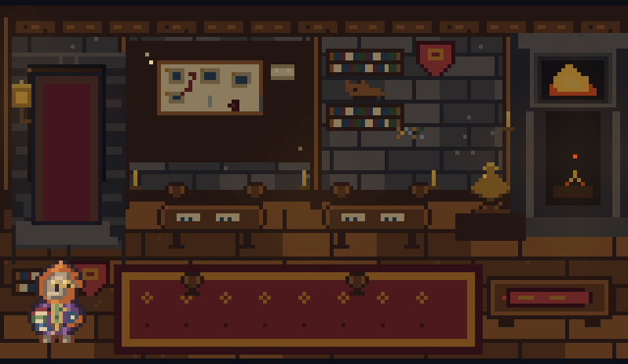

# Production proportional Hall integration — 2026-11-17

The owner approved the Storybook direction, then explicitly requested “yes
integrate the hall”. The production Guild Hall now uses the same canonical
160x90 RGB scene and authored masters through a negotiated Kitty output adapter.
No sprites are downsampled. Source authority, persistence, counsel and agent
commands remain unchanged. This is local, unreleased work on the existing dirty
`main` checkout at `9c52761`; earlier unrelated changes are preserved.

[Decision and implementation contract](../../adr/0002-production-hall-fit.md) ·
[Native review checklist](../../manual-test/production-hall-fit.md) ·
[Storybook approval](../2026-11-17-storybook-hall-fit/user-approval.md)

## Result

- Shared pure fit/projection lives in `src/scene/fit.rs`. Storybook retains a
  compatibility re-export; production imports no Storybook modules.
- `src/ui/hall_fit.rs` fits the complete canonical Hall at integer physical-pixel
  scale with letterboxing. One header and two footer rows keep standing,
  selected identity/condition, counsel count and existing hints/notices outside
  the image placeholders. The original scene renderer owns all art/animation.
- The same cell-centre transform projects mouse regions into existing input and
  reducer coordinates. All visible actors and the Librarian must be addressable.
- A single startup Picker query serves both portraits and Hall capability.
  Unsupported/missing geometry, tmux, ANSI16 preference, tiny panes, saturated
  canonical stations and all parchment/card surfaces use the responsive
  half-block path. The Delve retains its camera/roster/output contract.
- Canonical composition now checks actual station allocation. Eleven working
  adventurers at one campaign station previously yielded only five actors;
  they now select a complete fallback composition.
- Cache content and geometry suppress identical uploads. Only two random owned
  image identities are used, with exact-ID deletion after replacement, fallback,
  view/overlay changes and normal/error/interrupt shutdown. Existing semantic
  deadlines own redraws; there is no native-only timer or persistence.

## Automated qualification

`just verify` passed **815 Rust tests across 66 runs**, **28 shell tests**,
formatting, Clippy with warnings denied and shell syntax checks.
`cargo build --release` and `git diff --check` passed. The final candidate SHA256
is `4fd035336cf17fd19fee0968ec9c344c5575065e78b072c6d303ccb7ecef0682`.
See [verification.json](verification.json) and the copied logs.

The capacity regression was reproduced first: eleven agents produced five
regions. The focused test then passed with eleven unique regions. Seven new
production-adapter checks cover every mouse cell at three pane sizes, selection
and Ledger actions, all eight parchment/card transitions, ANSI16, graphics and
geometry fallback, tiny panes, cache/resize cleanup, unchanged uploads and
semantic animation deadlines. Existing feature-enabled Hall/Delve and shared
pixel-preservation tests passed in the full gate.

The first full gate stopped at an existing source-boundary assertion that assumed
painting lived directly in `terminal.rs`. It now follows the runtime's call to
`ui/hall_fit.rs` and retains all renderer/overlay assertions plus the production
boundary against Storybook. The subsequent complete gate passed.

## Release-binary PTY and pixel evidence

[pty-receipt.json](pty-receipt.json) records four isolated scenarios against the
actual release executable, with no Herdr environment or agent processes:

- negotiated Kitty: static upload suppression, grid resize, transformed Librarian
  mouse target, Ledger page navigation, return to fitted Hall, Delve half-block
  output and clean shutdown;
- unsupported graphics: zero native uploads with usable Ledger access;
- missing query and kernel pixel geometry: zero native uploads with usable Ledger;
- negotiated Kitty plus SIGINT: the same transitions and terminal restoration.

Both native runs emitted five images (four world uploads plus one Ledger image)
and four narrow world deletions using at most two world identities. Ledger image
identity was never targeted. Raw mode, alternate screen and mouse capture were
restored in every scenario. Transcripts and isolated state directories remain
under `/private/tmp/questmancer-production-hall-fit-20261117/`.

The first actual release upload was decoded and compared against the shared
production projection: **every RGBA byte matches at 800x464 physical pixels**.
[transport-pixels.json](transport-pixels.json) records its digest. This image is
an empty, disconnected fixture; it is a transport reconstruction, not a screenshot:



Reproduce after `cargo build --release`:

```sh
python3 docs/reviews/2026-11-17-production-hall-fit/pty_probe.py
bash docs/reviews/2026-11-17-production-hall-fit/regenerate.sh
python3 docs/reviews/2026-11-17-production-hall-fit/verify_transport.py
```

These scripts use isolated PTYs and temporary state, with no live Herdr pane
operations. Pixel comparison uses Python's standard library; no Python dependency
installation is required.

## Retained dogfood refresh

Herdr client/server freshly reported **0.9.5 / protocol 22**, no restart needed
and no stale server binary. Fresh terminal/process/synthetic-receiver checks
verified ownership before mutation. The first refresh attempt stopped before
sending input because the expected card had already been closed; a fresh plain
Hall inspection then permitted the owned UI refresh.

Only `w8:pY`, terminal `term_660769b53dfe0f`, was gracefully stopped and relaunched
through its existing isolated launcher. Runtime PID changed from `3116` to
`45568`, running the candidate above. The current focus `w8:pY` was preserved.
All four synthetic identities/statuses and all five persona records were
unchanged. `owned-work.json` retained SHA256
`add369a5baacfbf8ad0c17dc69812960c730f1b75d3c6bc71ce3d69a4c0b1804`.
Plugin logs were empty. [live-refresh.json](live-refresh.json) and the two reduced
owned-resource inventories record the result. Real/unknown panes, the shared
server, plugin registration and the separate Storybook handoff were preserved.

The **Questmancer dogfood** tab is left on the Guild Hall with its party open.
The selected footer's presence in the text receipt confirms the fitted adapter
branch was used. Herdr's text buffer exposes neither the visible image nor a
native visual verdict; it is not evidence of correct terminal placement.

## Remaining acceptance

The owner approved the direction and production integration. Exhaustive native
appearance, animation smoothness, mouse precision, resize, visibility/reconnect
and other-terminal acceptance remain unreviewed. Computer Use cannot inspect
Ghostty; no alternate UI-automation route was used. Follow the linked manual
checklist and retain these limits when recording approval.

The upload canvas is bounded to four million pixels and scale16; animation still
reuploads changed frames, so native performance requires human review. Complete
kernel pixel geometry refreshes font/cell axes during drawing; when a host omits
those axes, startup geometry remains in use and font zoom may require reopening.
No commit, push, release, installation or shared-server restart was performed.
Synthetic resources and evidence remain retained as requested.
