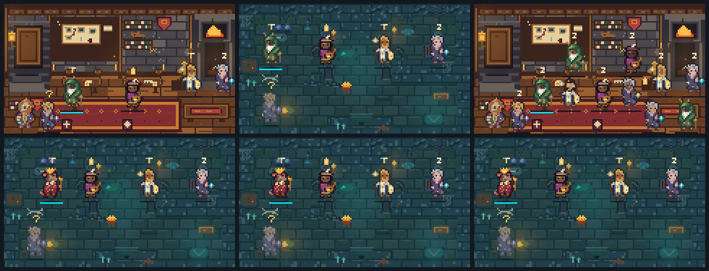
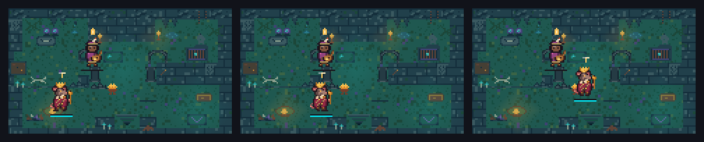
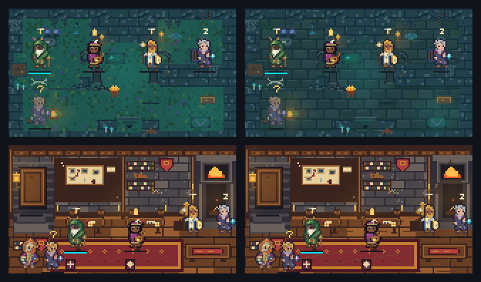

# Core UX room studies

The [core UX plan](../../plans/2026-11-18-core-ux.md) tracks the agreed order.
The user approved all three studies for production integration. These are
deterministic fixture-room captures, enlarged from the 160×90 source pixels.
The integrated renderer still needs a Ghostty check for appearance and mouse
handling.

## Integrated rooms

The top row shows the new Hall, the new Delve, and an eleven-adventurer Hall
where a neighbouring sprite occupies the usual counsel marker position.
The bottom row samples Rat Royalty at 0, 625 and 1,500 ms after a fresh Working
observation. The selected silhouette, marker and floor highlight move together.
All six panels come from `FitScene::project` with fixed fixtures and are
enlarged three times from the authored room pixels.

## Delve walk

Read left to right. Rat Royalty already shows Working throughout the walk.
The second adventurer stays at their station with the counsel signal. At the
destination, the walk deadline stops. Reduced and Still settle immediately.

Open `world.delve-walk` in Storybook. Space replays the route and `m` changes
motion. At compact sizes, use negotiated native fit for the complete walk.
Check whether the moving adventurer remains easy to click and the stationary
counsel signal still stands out.

In the fitted production Delve, look for the short approach to an adventurer's
usual station when Herdr reports fresh work. A station needs a clear aisle for
this movement. Reduced and Still motion show the adventurer at the station.

## Room materials

The current fitted rooms are on the left and the studies are on the right.
The Delve is above the Hall. The paired views use the same actor and landmark
positions. The Delve changes floor tiles, threshold edges and foot shadows.
The Hall changes grain, rug wear and the hearth surround.

Compare `world.delve-fit` with `world.delve-materials` and `world.guild-fit`
with `world.guild-materials`. Start at the pane size used for daily work.
Review route readability, sprite separation, and whether the material details
stay secondary to the party.
